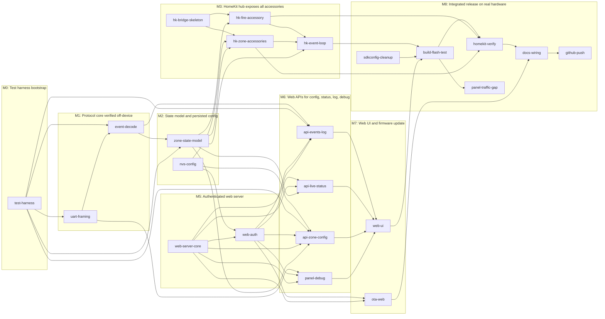

# TODO — Paradox Spectra 1738 → HomeKit hub

Refactor plan: expose the alarm panel as a HomeKit **bridge** with one accessory per zone (1–16) plus a fire alarm accessory, and add an authenticated web server. Wi-Fi setup remains on ESP-IDF's stock unified provisioning flow over BLE; a project-specific SoftAP flow is out of scope.

Every milestone lists the work items it contains **and** the tests that must pass before it is considered done. Test IDs are stable — reference them in commits and issue threads.

## Status legend

| Mark | Meaning |
|---|---|
| `[ ]` | not started |
| `[~]` | in progress |
| `[x]` | done |
| `[!]` | blocked |
| `[-]` | removed from scope |

## Milestones

| # | Milestone | Work items | Tests | Status |
|---|---|---|---|---|
| M0 | Test harness bootstrap | 1 | 4 | [x] |
| M1 | Protocol core verified off-device | 2 | 6 | [x] |
| M2 | State model and persisted config | 2 | 6 | [x] |
| M3 | HomeKit hub exposes all accessories | 4 | 7 | [~] |
| M4 | Custom SoftAP provisioning (dropped; keep stock ESP-IDF BLE) | 0 | 6 | [-] |
| M5 | Authenticated web server | 2 | 9 | [~] |
| M6 | Web APIs for config, status, log, debug | 4 | 8 | [ ] |
| M7 | Web UI and firmware update | 2 | 7 | [~] |
| M8 | Integrated release on real hardware | 5 | 7 | [~] |

## Ready to start (no open prerequisites)

- [ ] `hk-bridge-skeleton` — Rebuilding the HomeKit bridge accessory
- [ ] `nvs-config` — Adding NVS-backed configuration store
- [ ] `uart-framing` — Rewriting the Paradox UART frame decoder

## Hard gates

One test is a stop-the-line risk. Resolve it before building on top of the answer:

- **T7.7 — OTA size budget.** Passed: the M7 image is 1,389,344 bytes, under the 1500 KiB target; no partition-table change is needed.

---

## M0 — Test harness bootstrap

A repeatable way to run tests: host-side Unity unit tests compiled with gcc against the vendored Unity 2.6.0 sources in ESP-IDF, plus a device smoke script and a single make/ci entry point.

### Work items

- [x] `test-harness` — Setting up the test harness
  Create test/host/ with a Makefile that compiles the vendored Unity 2.6.0 sources from
  /home/nicolas/Source/esp-idf/components/unity/unity/src with gcc for host-side unit tests of
  pure logic (frame decode, state model, config validation, JSON handlers), using
  -fsanitize=address,undefined and optionally thread. Add test/device/smoke.sh for serial boot
  verification, a PARADOX_SIMULATOR build mode that feeds recorded frames instead of UART2, and a
  top-level Makefile "check" target running host tests then idf.py build.

### Validation tests

| # | Test | Kind | How to run | Pass criteria | Status |
|---|---|---|---|---|---|
| T0.1 | Host Unity harness builds and runs | host-unit | make -C test/host check. Compiles the vendored Unity 2.6.0 sources from $IDF_PATH/components/unity/unity/src plus test_smoke.c with plain gcc and runs the binary. | Exit code 0 and Unity prints its summary line "N Tests F Failures I Ignored" followed by OK. No ESP-IDF headers in the suite (UNITY_INCLUDE_CONFIG_H deliberately left undefined, since IDF's unity_config.h pulls in esp_err.h/sdkconfig.h). | [x] |
| T0.2 | Single entry point fails on a broken test | build | make check-fail builds test/host/samples/deliberate_failure.c (asserts 1 == 2) and runs it, asserting non-zero exit AND that the output names deliberate_failure.c:`<line>`. make check runs host tests, the smoke analyzer self-test, then both device builds. | make check-fail exits 0 only when the deliberate failure is reported with file and line and a non-zero status; make check exits 0 on a clean tree. | [x] |
| T0.3 | Device smoke script captures boot log | device | test/device/smoke.sh (no --flash by default): opens the port, de-asserts DTR/RTS, pulses RTS to hard-reset EN, then reads for --seconds (default 10) at 115200 and analyses the log. --self-test exercises the analyzer on synthetic healthy/crashing/truncated/error logs with no hardware. make smoke FLASH=1 adds idf.py flash first. | Exits 0 only when "HAP Started" and "Returned from app_main()" are both present and there are zero crash markers (Guru Meditation, abort(), Stack canary, LoadProhibited, ...) and zero ESP-IDF error-level lines ("E (n) tag:"). --self-test exits 0 with all five analyzer cases correct. | [x] |
| T0.4 | Frame injector / simulator mode exists | device | make build (simulator off) and make build-sim (CONFIG_PARADOX_SIMULATOR=y via apps/paradox1738/sdkconfig.simulator.defaults, separate -B build-sim and -D SDKCONFIG=sdkconfig.simulator). Compare xtensa-esp32-elf-strings of the two binaries. | Both variants build clean. Simulator binary contains "SIM event" and the "simulator enabled: UART2 not initialised" warning and no "Recv str"; default binary contains "Recv str" and no simulator strings. Runtime web-page/console toggle deferred to M5 when the web server exists. | [x] |

---

## M1 — Protocol core verified off-device

The Paradox serial stream decodes correctly and self-heals on byte loss, proven by host unit tests with recorded golden frames - no hardware needed to trust the decode layer.

### Work items

- [x] `event-decode` — Adding the event/category decode layer
  Introduce enums + a decode table for the Spectra 1738 protocol: EventId 0 Zone OK, 1 Zone Open,
  2 Partition Status, 12 Delayed-zone breach, 13 Arm, 15 Disarm, 20 Zone in alarm, 21 Fire alarm,
  22 Zone alarm restore, 23 Fire restore, 24 Special alarm (cat 2 = Fire via keys), 25 Auto zone
  shutdown, 26/27 Zone tamper/restore, 28/29 System trouble/restore. CategoryId 1-16 = zones.
  Produce a decoded event struct with class, zone, and open/closed semantics.
  Note: the first three ids come from the reference implementation's *source* table
  (`Program.cs`), not its README table, which is shifted by one for those ids. Ids 3 and 4
  are never emitted. Confirmed against a live raw UART capture (M6 status notes).
  *Depends on:* `test-harness`, `uart-framing`
- [x] `uart-framing` — Rewriting the Paradox UART frame decoder
  apps/paradox1738/main/paradox1738.c: replace the current read with a resyncing 4-byte frame
  decoder (the panel stream has no framing header, so a lost byte permanently misaligns reads).
  Check the actual uart_read_bytes return length instead of assuming 4. Remove the unsafe
  ESP_LOGI("%s", (char*)data) on the non-terminated 4-byte buffer (line 27). Define
  paradox1738_deinit() which is declared in paradox1738.h but never implemented. Expose a stats
  counter for framing/overrun errors for the debug endpoint.
  *Depends on:* `test-harness`

### Validation tests

| # | Test | Kind | How to run | Pass criteria | Status |
|---|---|---|---|---|---|
| T1.1 | Golden frame decode table | host-unit | Move the byte-decode logic into a pure function (no driver calls) and unit test it against every EventId in the reference: 0,1,2,5,6-11,12,13,14,15,16,17,18,19,20,21,22,23,24,25,26,27,28,29,30 with representative CategoryIds. Run: make -C test/host test | All vectors decode to the expected EventId, CategoryId and event class. EventId 0 maps to closed, 1 to open, 21 to fire-alarm, 23 to fire-restore. Decode lives in `main/paradox_proto.c`; covered by `test/host/test_decode.c` (9 tests) plus `test_simframes.c`, which replays the whole recorded simulator table through the real decoder. A proposed renumbering that moved Partition Status from 2 to 3 was tried and rejected: it breaks the idle-panel broadcast replay (`test_idle_panel_broadcast_decodes_cleanly`) and the never-used-id guard, so the 0/1/2 numbering with ids 3 and 4 unused stands. | [x] Live-panel confirmation (192.168.4.30, live Spectra 1738): the idle quartets decode as `04219200` -> event 1 category 2 "Zone Open", `00219200` -> event 0 category 2 "Zone OK", `08019200`/`08119200` -> event 2 categories 0/1 "Partition Status", and ids 3 and 4 never appear in 9057 frames. Renumbering Partition Status to 3 breaks that capture, so 0/1/2 is now confirmed twice - once by the bench capture, once by the live panel.|
| T1.2 | CategoryId/EventId bit math matches the reference | host-unit | Feed the documented example bytes and assert EventId = data[0] >> 2 and CategoryId = ((data[0] & 3) << 4) + (data[1] >> 4), including the boundary cases where data[0] low bits are 0b11 and data[1] high nibble is 0xF. | Zone 16 (CategoryId 16) and zone 1 decode correctly; no off-by-one at the 10-bit field boundary; bits 1-4 of the 16-bit field are ignored. | [x] |
| T1.3 | Decoder resynchronises after a dropped byte | host-unit | Feed a valid frame, then a stream with one byte deleted mid-way, then more valid frames. Assert the error/resync counter and that the decoder returns to aligned output. | After at most one discarded frame the next decoded event matches the expected fixture; framing-error counter increments exactly once per injected corruption; no infinite loop when fewer than 4 bytes remain. | [x] |
| T1.4 | Short read never produces a phantom event | host-unit | Stub the read to return 0, 1, 2 and 3 bytes and call the decoder. | Each case returns "no event" without touching the caller struct, and no buffer is read past its 4-byte bound (host build uses -fsanitize=address,undefined and reports no errors). | [x] |
| T1.5 | No unsafe %s logging of the raw buffer | security | grep -n "%s" over the UART sources and run the host decoder under ASAN with a deliberately non-NUL-terminated 4-byte buffer. | Zero %s conversions applied to the UART buffer; frames are logged as hex bytes instead. ASAN reports no overread. | [x] |
| T1.6 | paradox1738_deinit implemented and idempotent | build | Call paradox1738_deinit() (declared in paradox1738.h but previously undefined) twice from a device test path. `make build-selftest` builds with `CONFIG_PARADOX_LINK_SELFTEST=y` (via `sdkconfig.selftest.defaults`, separate `-B build-selftest`); app_main() then runs `paradox1738_link_selftest()`, which inits, calls deinit twice and re-inits. Flashed to `/dev/ttyUSB0`; boot log showed `LINK SELFTEST: PASS (deinit implemented and idempotent)`. | Links without undefined reference; second call returns without crashing or double-freeing the UART driver. | [x] |

---

## M2 — State model and persisted config

One authoritative, thread-safe state model for zones 1-16 plus fire, and a versioned NVS config that survives reboot and can be edited programmatically.

### Work items

- [x] `nvs-config` — Adding NVS-backed configuration store
  Persist a config blob in NVS: per-zone enabled flag, HomeKit service type
  (contact/motion/smoke/leak), user-visible name, plus global flags (panel debug on/off, web auth
  hash). Schema v1 uses a stable byte encoding; v0 migrates by defaulting the new auth hash.
  Defaults enable all zones as contact sensors named "Zone 1" through "Zone 16". The NVS load/save
  API validates values and falls back with a warning for corrupt or unsupported blobs. Config
  changes require a reboot to rebuild the HomeKit accessory set.
- [x] `zone-state-model` — Building the central zone/fire state model
  New module holding authoritative state for zones 1-16 plus the fire alarm: open/closed, in-
  alarm, tamper, bypassed, last-change timestamp, and fire alarm/restored. Thread-safe (FreeRTOS
  mutex on device; pthread mutex on host) with atomic snapshots and callbacks only on real changes.
  UART/HAP/web integrations consume this shared API in their respective milestones.
  *Depends on:* `event-decode`, `test-harness`

### Validation tests

| # | Test | Kind | How to run | Pass criteria | Status |
|---|---|---|---|---|---|
| T2.1 | State model is thread-safe | host-unit | `make -C test/host check SAN=thread CC=gcc-16`; 2 pthread writers each toggle one zone 100k times while 2 readers snapshot. | No data-race or deadlock reports; snapshots preserve the zone/open/timestamp invariants. | [x] |
| T2.2 | Zone index bounds and invalid input rejected | host-unit | `test/host/test_state.c` exercises indexes 0, 16, 17, -1, an out-of-range fire category, and an unknown event class. | Out-of-range indexes return an error code and leave state untouched; valid zone range is exactly 1-16. | [x] |
| T2.3 | State change notifications fire once per real change | host-unit | Send zone-open twice, then zone-closed; count observer callbacks. | Exactly two notifications for the two real transitions; the duplicate produces none. | [x] |
| T2.4 | NVS config round-trip survives reboot | device | `make build-configtest`, flash it, then capture boot with `test/device/smoke.sh --port /dev/ttyUSB0 --seconds 45 --allow-errors`. Isolated `pconfig_test` namespace writes Zone 3 name, Zone 7 motion type and disables Zone 12; the test reboots and verifies every field and all untouched defaults. | Boot log reports `CONFIG SELFTEST: PASS`; production `paradox` namespace is not modified. | [x] |
| T2.5 | Config schema versioning and migration | device | Same isolated device self-test writes a v0 blob, reboots into the v1 loader, then tests a corrupt blob on another reboot. | Migration preserves configured fields and defaults the new hash; corrupt data logs a warning and falls back to defaults without erasing NVS. Device log reports `CONFIG SELFTEST: PASS`. | [x] |
| T2.6 | Config validation rejects bad values | host-unit | `make -C test/host check` runs `test_config.c` with invalid service type, a 65-character name and an empty name. | Each invalid value is rejected with an explicit result; valid 64-character names fit without overflow. | [x] |

---

## M3 — HomeKit hub exposes all accessories

The bridge advertises itself plus 16 zone accessories plus the fire accessory in HomeKit, with stable AIDs and correct characteristic updates driven by panel events.

### Work items

- [x] `hk-bridge-skeleton` — Rebuilding the HomeKit bridge accessory
  `apps/paradox1738/main/app_main.c` registers the bridge with product data and Wi-Fi transport.
  The unusable firmware-upgrade service with an empty server certificate was removed, and the task
  and log tag now use hub-specific names.
- [x] `hk-event-loop` — Wiring panel events to HomeKit characteristics
  The app reads decoded panel events, applies them to the shared state model, and updates the
  corresponding HomeKit characteristics through a state observer. Repeated state values do not
  produce notifications; invalid state updates are logged.
  *Depends on:* `hk-fire-accessory`, `hk-zone-accessories`, `zone-state-model`
- [x] `hk-fire-accessory` — Adding the fire alarm Smoke Sensor accessory
  A bridged smoke sensor exposes SmokeDetected, StatusActive, StatusFault, and StatusTampered.
  SmokeDetected follows EventId 21/23 and EventId 24/category 2; StatusFault follows fire-loop
  trouble and restore (EventId 28/29, category 7). No independent fire-loop tamper event is
  currently modeled, so StatusTampered remains clear.
  *Depends on:* `hk-bridge-skeleton`, `zone-state-model`
- [x] `hk-zone-accessories` — Creating 16 bridged zone accessories
  Before `hap_start()`, the app creates an accessory for each enabled zone using its configured
  name and contact, motion, smoke, or leak service. Alarm/bypass updates StatusFault, tamper updates
  StatusTampered, and AIDs use stable zone-number identifiers rather than names.
  *Depends on:* `hk-bridge-skeleton`, `nvs-config`, `zone-state-model`

### Validation tests

Host tests, production and simulator builds, and the boot-log analyzer passed.
The attached board was factory-reset and flashed with the M3 image. It boots
without crash/error logs and reports 18 accessories (bridge, 16 zones, fire)
with the expected service UUIDs. All 18 AID/name pairs matched after reboot and
reflash without erasing NVS. The user confirmed Apple Home pairing and accessory
visibility, later removed the bridge, and has now paired it again with the
production image. The production image was rebuilt and reflashed without
erasing NVS and passed the 20-second boot smoke test. A 120-second simulator run
exercised zone, alarm, tamper, bypass, fire, and fire-loop-trouble state changes
and logged HAP value changes. A
two-hour simulator soak captured 226 heap samples over 119.45 minutes. After
the initial warmup, internal free heap rose by 632 bytes (about 322 bytes/hour),
and minimum free heap remained 135604 bytes. The normalized full log passed the
boot/crash/error analyzer with no issues. The monitor was stopped at the
two-hour timeout; its captured log continued past two hours of device uptime.
In a later 90-second simulator run, the paired controller completed Pair Verify
twice; the user observed Zone 1 change to open in Apple Home while the simulator
reported that state change and HAP value-change output. This confirms at least
one controller-visible characteristic update. The user then confirmed seeing
all zone sensors and the fire detector transition open/alarm and return to
closed/clear one by one in Home. Production firmware was restored without
erasing NVS and passed the boot smoke test. A focused Zone 1-only simulator
replay emitted alarm/restore, tamper/restore, and open/close events without
bypass or events for other accessories. The user confirmed in Home that Zone 1
alarm/fault and tamper indicators each set and cleared, the contact state
opened and closed, and no other zones changed. The device log showed
subscriptions and HAP notification sends; the captured HomeKit session later
disconnected. Production firmware was restored without erasing NVS and passed
the boot smoke test. A separate fire-loop retest showed StatusFault changing
in Home; StatusActive and fire StatusTampered have not been independently
checked.

| # | Test | Kind | How to run | Pass criteria | Status |
|---|---|---|---|---|---|
| T3.1 | Accessory count and types in the HAP database | device | At runtime dump the registered accessories/services (hap_acc_get_first / hap_serv_get_first walk, or GET /api/homekit after M6). Alternatively fetch the HAP /accessories JSON from the paired home over the network. | With default config, exactly 1 bridge + 16 zone accessories + 1 fire accessory. Each enabled zone carries its chosen service type UUID and a Name characteristic matching config; the bridge reports HAP_CID_BRIDGE. | [x] |
| T3.2 | Pairing succeeds with all accessories present | manual-homekit | Factory-reset the device, provision Wi-Fi, pair from the iOS Home app using the printed QR / X-HM URL, then inspect the accessory list. | Pairing completes on the first attempt; Home shows the hub plus 16 zones plus the fire sensor with no "uncertified/unresponsive" entries and no pairing error. | [x] |
| T3.3 | Stable AIDs across reboot and reflash | device | Record every accessory AID, reboot, record again; then flash a new build and record again. | AID set is identical in all three runs (hap_get_unique_aid derived from a stable per-zone key, not creation order), so Home does not orphan accessories after an update. | [x] |
| T3.4 | Zone open/close drives ContactSensor.ContactSensorState | device | Inject simulator frames for zone EventId 1 then EventId 0 (or trigger the physical zone) and watch Home plus the HAP event/notification log. | Zone sensors visibly transition open then closed in Home with no unrelated zone change. | [x] |
| T3.5 | Alarm, tamper and bypass map to the right characteristics | device | Inject Zone 1 EventId 20/22 and 26/27 without bypass; observe HomeKit plus StatusFault/StatusTampered. | Alarm sets and restore clears StatusFault; tamper sets and restore clears StatusTampered; no unrelated zone changes. Alarm/tamper pass; bypass remains unverified in Home. | [~] |
| T3.6 | Fire accessory reacts to EventId 21/23, 24 cat 2 and fire-loop trouble | device | Inject fire alarm (21), fire restore (23), special alarm cat 2 (fire keys), and system trouble/restore (28/29, category 7). Watch SmokeDetected plus StatusActive/StatusFault/StatusTampered. | Fire alarm/restore and fire-loop StatusFault change have been observed in Home. StatusActive and StatusTampered still need explicit characteristic verification. | [~] |
| T3.7 | No spurious updates and no heap leak over long run | device | Run with simulator frames cycling continuously for at least 2 hours, logging free heap and internal heap minimum every 30 s. | Free heap is flat after warmup (drift under 2 KB per hour); notification queue never overflows; zero HAP error logs. | [x] |

---

## M4 — Custom SoftAP provisioning (dropped)

Keep ESP-IDF's stock unified Wi-Fi provisioning manager and its existing BLE
transport. It displays the stock provisioning QR payload when the device has no
saved Wi-Fi credentials; Bluetooth remains enabled for that flow. Do not add a
project-specific SoftAP, provisioning web API, custom AP recovery behavior, or
disable Bluetooth to reclaim heap. M4's custom-SoftAP acceptance tests are
retired; test IDs remain reserved for traceability.

| # | Retired test | Status |
|---|---|---|
| T4.1 | Project-specific SoftAP appears when unprovisioned | [-] |
| T4.2 | Provisioning over the project-specific SoftAP | [-] |
| T4.3 | Project-specific SoftAP recovery after credential failure | [-] |
| T4.4 | Bluetooth fully disabled for SoftAP-only operation | [-] |
| T4.5 | Heap budget measured with Bluetooth disabled | [-] |
| T4.6 | Unicore decision tied to the Bluetooth-off heap experiment | [-] |

---

## M5 — Authenticated web server

A reachable, authenticated HTTP server on port 80 that coexists with HAP (8080) and never leaks credentials. Wi-Fi provisioning stays on ESP-IDF's stock BLE flow, not a web or SoftAP endpoint.

### Work items

- [x] `web-auth` — Adding authentication to the web server
  The web UI can change zone config, so it must not be open: token/cookie
  session with a login password stored as a hash in NVS, CSRF or same-origin check for mutating
  routes, and no plaintext credential logging (the existing app_wifi.c:192-195 logs the Wi-Fi
  password - remove that).
  *Depends on:* `nvs-config`, `web-server-core`
- [x] `web-server-core` — Adding the embedded web server
  esp_http_server instance on port 80 (HAP core owns 8080). Serve a small static UI from LittleFS/SPIFFS or embedded binary data, plus
  JSON API routes under /api/. Add a config option to disable the server entirely.

### Validation tests

| # | Test | Kind | How to run | Pass criteria | Status |
|---|---|---|---|---|---|
| T5.1 | Server reachable on 80 alongside HAP 8080 and stock BLE provisioning | device | Probe http://`<ip>`/ and http://`<ip>`:8080/accessories (HAP) from a laptop on the provisioned network; verify the stock BLE provisioning flow remains available when Wi-Fi is unprovisioned. | Both HTTP services respond on their own port with no bind conflict; BLE provisioning works through ESP-IDF's provisioning manager; boot log shows no httpd "Failed to bind" error. | [x] |
| T5.2 | Unauthenticated requests are rejected | security | With auth enabled, curl every mutating route (POST/PUT/DELETE) and the config/status reads without a session cookie. | Mutating routes return 401/403; no config change occurs (verified by re-reading). Only explicitly public routes (login, static assets, optional status) answer. | [x] |
| T5.3 | Session token is not guessable and expires | security | Log in, capture the cookie, check its length/entropy and that it is HttpOnly + SameSite; wait past the TTL and retry. | Token is at least 128 bits of randomness, HttpOnly and SameSite=Strict/Lax; expired or forged tokens are rejected; logout invalidates the token server-side. | [x] |
| T5.4 | Password stored only as a salted hash | security | Dump the NVS config blob (or read it through the API) and grep the whole image: strings build/paradox1738.bin \| grep -i `<password>`. | The plaintext password appears nowhere in NVS or the binary; only the hash and salt are stored. Changing the password updates both. | [x] |
| T5.5 | Wi-Fi credentials never logged in plaintext | security | grep -n over app_wifi.c and the web layer for logging of the proof/pass, then provision a network with a known sentinel password and capture the full serial log. | The sentinel password never appears in the serial log or any HTTP response; the existing plaintext log at apps/common/app_wifi/app_wifi.c:192-195 is removed or masked. | [~] |
| T5.6 | CSRF / same-origin protection on mutating routes | security | Send a POST with Origin/Referer from a foreign host and no CSRF token, using a valid session cookie. | Rejected with 403 and no state change; the same request with the correct token succeeds. | [x] |
| T5.7 | Path traversal and oversized bodies blocked | security | Request /../../etc/config style paths and POST an oversized JSON body (over the documented limit) and malformed JSON. | Traversal returns 404/400 without serving files; oversized bodies are refused with 413; malformed JSON returns 400 and leaves config untouched. | [x] |
| T5.8 | Web server can be disabled by config | build | Set the disable option, rebuild, probe port 80. | Port 80 is closed and no httpd task is created; HAP on 8080 still works. | [x] |
| T5.9 | Simulator can be toggled at runtime | device | From the web debug page (or console command), enable the recorded-frame replay while the device runs, observe synthetic events arriving, then disable it and confirm events stop. | Toggling takes effect without a reboot; with the simulator off and no panel wired, no events are produced. Frames still decode to the same EventId/CategoryId as the compile-time build. | [x] PASS on 192.168.4.30 (live panel, `fb403b2`): `POST /api/debug/simulator` answered `{"ok":true,"active":true}` with no reboot, and the event log afterwards held 48 entries = all 44 recorded frames plus the 4 real panel frames the tap had seen, including `{0x60,0x20,0xA0,0x00}` decoding as event 24 category 2 "Special Alarm" exactly as the compile-time table states. On the bench board with no panel wired and the simulator never started, a five-minute serial capture logged zero `Recv event` and zero `SIM event` lines. Live reads resume by themselves when the replay ends: the main loop sees `paradox1738_simulator_complete()`, restores the pre-replay state snapshot and calls `paradox1738_simulator_finish()`, and real panel frames arrived again afterwards (frames_ok 48 -> 72 within four minutes) with every zone closed/clear and fire clear afterwards, so the simulated fire/alarm frames did not stick.|

The enabled firmware is flashed and passed the boot smoke test with Wi-Fi,
HomeKit, and the web server running. Port 80 root, health, and auth-status
requests returned 200; port 8080 responded to an HAP accessories request.
Bootstrap login completed in 3.53 seconds and issued a 64-character session
cookie with HttpOnly and SameSite=Strict; logout revoked it (reuse returned
401). An unauthenticated password change returned 401, and a foreign-origin
password change with a valid session returned 403. The user subsequently
confirmed factory-reset provisioning over stock BLE, web login, and password
change on the device; T5.1 is complete. T5.8 also builds with the server
disabled. Session expiry, Wi-Fi sentinel log capture, and the disabled-server
hardware probe remain unverified; M5 stays in progress.
The additional T5.2 probe confirmed unauthenticated password-change and logout
requests return 401; unauthenticated zone/status/event/debug paths return 404
because those M6 routes are not implemented yet. Auth status remained unchanged.
The public root and health endpoints returned 200, and auth status remained
configured before and after the unauthorized attempts.
For T5.4, a read-only dump of the active NVS partition contained a current
schema-v2 config record (1123 bytes) with password_set=true and nonzero 16-byte
salt and 32-byte hash; the record format has no plaintext-password field. The
firmware image contains no compiled password value, only the bootstrap log
format and generic authentication strings. Host config codec/migration tests
passed (6/6). The permanent password was not collected or exposed for a
literal-value search; storage was verified via the active record structure
and serialization code.
T5.2 is complete for the implemented routes: unauthenticated password-change
and logout mutations returned 401, and the planned M6 reads are not registered
(404) and disclose no data. T5.6 is complete: a foreign-origin password change
with a valid session returned 403, while the user confirmed successful
same-origin login and password change. T5.7 is complete: raw and percent-
encoded traversal paths returned 404, a 514-byte JSON body returned 413, and
malformed JSON returned 400. The complete host suite passed (33 tests).
T5.5's source review found no Wi-Fi password/SSID logging, but the sentinel
credential serial-capture portion is still unverified. T5.9 cannot be exercised:
the simulator is compile-time only and no runtime UI/console toggle exists.
For T5.8, a fresh isolated build with CONFIG_PARADOX_WEB_SERVER disabled
succeeded (1,346,656-byte image); its sdkconfig retains HAP on 8080 and the
firmware contains no web_server_start/web_server_stop symbols. The live-device
port-80 probe passed: port 80 refused connections, HAP on 8080 responded, and
the boot log contained no web-server start/error lines. The enabled firmware
was then restored without erasing NVS; its smoke test passed and port 80 health
returned 200.
T5.3 passed in the integrated browser without sharing the password: after
1,805 seconds, the authenticated logout request returned 401. Earlier device
checks confirmed a 64-character random session token, HttpOnly and
SameSite=Strict flags, forged-token rejection, and logout revocation.

---

## M6 — Web APIs for config, status, log, debug

JSON APIs that read/write zone config, stream live state, expose the event log, and show raw panel frames for protocol work.

### Work items

- [x] `api-events-log` — Adding the panel event log
  RAM ring buffer (sized in config) of decoded events with timestamps, exposed at GET /api/events
  with class/zone filters and a clear action. Optionally persist the last N events to NVS so they
  survive a reboot for troubleshooting.
  *Depends on:* `event-decode`, `test-harness`, `web-auth`, `web-server-core`
- [x] `api-live-status` — Adding live status endpoint and event stream
  GET /api/status returns all zone + fire states as JSON with timestamps, and an SSE (or long-
  poll) stream pushes state changes so the UI updates without polling. Back it off the state model
  change notifications rather than the UART task directly.
  *Depends on:* `web-auth`, `web-server-core`, `zone-state-model`
- [x] `api-zone-config` — Adding the zone configuration API
  GET /api/zones returns the 16 zone configs plus current state; PUT /api/zones/{n} updates
  name/type/enabled and writes NVS, then reports that a reboot is required to apply to HomeKit.
  Validate type against the supported enum and reject out-of-range indexes.
  *Depends on:* `nvs-config`, `test-harness`, `web-auth`, `web-server-core`, `zone-state-model`
- [x] `panel-debug` — Adding the raw panel debug view
  Debug endpoint streaming raw 4-byte frames as hex with decoded interpretation side by side, plus
  UART error/framing counters, so protocol work can continue from a browser without a serial
  cable. Gate it behind the debug config flag and auth.
  *Depends on:* `uart-framing`, `web-auth`, `web-server-core`

### Validation tests

| # | Test | Kind | How to run | Pass criteria | Status |
|---|---|---|---|---|---|
| T6.1 | GET /api/zones returns all 16 zones with state | device | Fetch the endpoint after login and validate JSON structure, IDs, required fields, and response size. | Exactly 16 entries, indexes 1-16, with string name/type, boolean enabled and live state fields, numeric timestamps, and a response under 8 KB. | [x] |
| T6.2 | PUT /api/zones/{n} persists and reports pending reboot | device | Temporarily rename zone 16, re-read it, restore the original config, and reboot/re-read to verify NVS persistence. | PUT returns success plus an explicit "reboot required for HomeKit" flag; the change is present immediately in the API and after reboot; HomeKit names/types only change after the reboot. | [~] |
| T6.3 | Invalid zone edits are rejected atomically | host-unit | Unit test the request handler with: index 0/17, unknown type, over-long name, truncated JSON body. | Each returns 4xx with an error message and no partial write to NVS (verified by re-reading all fields). | [~] |
| T6.4 | Live status stream pushes changes within 2 s | device | Open the SSE stream from a laptop, inject a zone-open frame, measure the delay to the pushed event. | Event arrives within 2 s of injection; stream stays open for at least 5 minutes without reconnect; disconnecting the client does not leak a session (client count returns to 0). | [~] 25 `event: status` pushes in 150 s to one SSE client while a second SSE client (raw stream) and 495 REST requests were in flight on 192.168.4.30; no reconnects and no dropped requests. Still unmeasured: the <=2 s delay from injection to push, the five-minute stream stability, and the client-count-returns-to-zero check. |
| T6.5 | Status endpoint matches HomeKit state | device | Compare GET /api/status against the HAP /accessories values for the same zones after the same injected frames. | No disagreement on any zone: open/closed, alarm, tamper and fire all match between the web view and HomeKit. | [ ] |
| T6.6 | Event log ring buffer behaves under load | host-unit | Push more events than the buffer holds and read it back; also test the clear action and class/zone filters. | Returns exactly the most recent N events in newest-first order, no gaps or duplicates; filters work; clear empties it; no allocation growth after 10k pushes. | [x] PASS in `test/host/test_event_log.c` (5 tests, all under -fsanitize=address,undefined with -Werror): 10 000 pushes through the ring, then the snapshot returns exactly PARADOX_EVENT_LOG_CAPACITY entries, newest first, with every timestamp accounted for (no gaps, no duplicates) and identical across two consecutive snapshots; clear empties it; NULL/zero-capacity calls are rejected. The class and zone filters are now exercised off-device through `paradox_event_log_matches()`, which the request handler calls instead of open-coding the two conditions - covered for unfiltered, zone-only, class-only and class+zone selection plus the limit. Documented behaviour: fire events classify as zone events on the detector's zone, so `?zone=2` includes them, and a partition report's category is never treated as a zone. No allocation growth is possible: the ring is a static array of the configured capacity. |
| T6.7 | Panel debug shows raw hex plus decode side by side | device | Inject a known frame with debug enabled and read the debug endpoint. | Raw bytes shown as hex (never as a string), decoded EventId/CategoryId/class shown next to them, and UART framing/overrun counters are present and increment on injected corruption. | [x] PASS on 192.168.4.30 (live panel, `fb403b2`): `GET /api/debug/panel` reports the counters `frames_ok 48, framing_errors 0, bytes_discarded 0, overruns 0` next to each frame as hex plus its decode, e.g. `"raw":"08119200","event_id":2,"category_id":1,"class":"partition_status","event":"Partition Status"`; nothing is printed as a string. `GET /api/debug/raw?bytes=2048` returns `capacity 2048, bytes_recorded 16, bytes_lost 0, bytes_retained 16, first_seq 0` plus the hex. Note: the raw tap sits on the UART read loop, so runtime-simulator frames never appear there by design - during the replay that logged 44 events the tap still held only the 16 bytes of real panel traffic. |
| T6.8 | Debug endpoints require the debug flag | security | Call the debug routes with the flag off, then on, and test unauthenticated access. | Off: 404 or 403 with no frame data leaked. On: data served, and only to an authenticated session. | [x] |

M6 endpoints are implemented: authenticated zone read/update with NVS persistence,
status snapshot and SSE stream, configurable RAM event history with filters and
clear, and debug controls/data gated by the persisted debug flag. Each decoded
event retains its original four-byte frame for debug output. Host tests pass for
atomic zone updates, event log ordering/wrap/clear under 10,000 pushes, and raw
frame preservation. ESP-IDF firmware build succeeds with the default 64-entry
event log (image 0x14e430 bytes, 16% partition free). The M6 firmware was
flashed without erasing NVS; boot smoke and the public health endpoint passed.
Authenticated API checks confirmed 16 zones in a 2,253-byte response, a zone
update and restore, rejection of invalid zone IDs/types without mutation, event
filters and invalid-filter rejection, and debug-flag gating (enabled: 200;
disabled: 404; unauthenticated: 401). The SSE stream delivered its initial
status snapshot within 93 ms and stayed open for five minutes without errors.
A verbatim raw UART tap is now published over Wi-Fi too: every byte the panel
UART task reads is kept in a RAM ring buffer and exposed as hex by
`GET /api/debug/raw` and `GET /api/debug/raw/stream`, including the bytes the
decoder discards while it resynchronises framing. Host tests cover the ring
ordering, wrap-around, gap accounting, and seek behaviour.

The tap paid for itself on first use. A 464-byte capture of an idle panel was
perfectly four-byte aligned yet the decoder reported 53 framing errors and
discarded 420 bytes - exactly four bytes per accepted frame. Replaying the
capture offline showed the panel broadcasts repeating groups of four quartets
(`04 21 a0 e0 / 08 01 a0 e0 / 00 21 a0 e0 / 08 11 a0 e0`) and that we accepted
only two of the four. The event table had been transcribed from the reference
project's README, but the reference *code* - and the panel - number the first
three events one lower: Zone OK 0, Zone Open 1, Partition Status 2, with ids 3
and 4 never emitted. Renumbering the table makes the whole capture decode with
zero framing errors; `test/host/test_framing.c:test_idle_panel_broadcast_decodes_cleanly`
replays the captured group as a regression test. After the fix the device ran
596 frames with `framing_errors 0`, `bytes_discarded 0` and `overruns 0`.

T6.1 and T6.8 passed. T6.2, T6.3, T6.4, T6.6, and T6.7 remain partial: reboot
persistence, remaining invalid-body cases, injected status-change latency and
disconnect cleanup, non-empty event filter coverage, and a known raw frame
still need validation. T6.5 remains pending because the unpaired HAP endpoint
does not expose accessory state for comparison.

---

## M7 — Web UI and firmware update

A phone-usable single-page UI covering setup, zones, live status, logs and debug, plus a safe web OTA with rollback.

### Work items

- [x] `ota-web` — Adding web-based firmware update
  Upload endpoint using esp_ota_ops writing the inactive slot, verify image, set boot partition,
  reboot; guard against exceeding the 1600K ota partitions (current build is ~1.45MB so headroom
  is thin). Add a rollback/boot-validity check and show running version + slot in the UI.
  *Depends on:* `web-auth`, `web-server-core`
- [x] `web-ui` — Building the single-page web UI
  Plain HTML/CSS/JS (no build chain) with tabs: Wi-Fi connection/provisioning status, zone list with editable
  name/type/enabled, live status dashboard showing all 16 zones + fire, event log, and panel
  debug. Wi-Fi credentials are entered through ESP-IDF's stock BLE provisioning flow, not the web UI.
  *Depends on:* `api-events-log`, `api-live-status`, `api-zone-config`, `panel-debug`

### Validation tests

| # | Test | Kind | How to run | Pass criteria | Status |
|---|---|---|---|---|---|
| T7.1 | UI loads on a phone on the provisioned LAN | manual | Provision Wi-Fi using ESP-IDF's stock BLE flow, connect the phone to that network, and open http://`<device-ip>`/ in Safari. | Page renders without external CDN assets (fully offline), all tabs reachable, controls usable at 390 px width. | [x] PASS: device page loaded; all five tabs rendered at 390 px configured width with no horizontal overflow |
| T7.2 | Zone config round-trips through the UI | manual | Rename two zones, change one type, disable one, save, reboot, reload the page. | All edits are shown after reboot; disabled zone disappears from HomeKit on the next pairing/refresh; no JS console errors during the flow. | [~] All changes persisted after reboot and original values were restored; HomeKit app's accessory refresh was not inspected |
| T7.3 | Live dashboard reflects physical triggers | manual | Open the dashboard, then open and close a real zone on the alarm panel. | Tile flips within 2 s with a timestamp; fire tile stays clear during a normal zone test. | [ ] |
| T7.4 | OTA upload flashes the inactive slot and boots it | device | Build a versioned image, upload through the web UI, watch the log, then reboot. | esp_ota writes the inactive slot, image validation passes, boot partition flips, the new version reports itself in the UI and boot log; the previous slot remains intact for rollback. | [x] PASS: `POST /api/ota` on 192.168.4.30 wrote 1,398,480 bytes to the inactive slot in 18.8 s (`{"ok":true,"restarting":true}`); the module came back in `ota_1` reporting `fb403b2` from `GET /api/system`, and the bench board boot log prints the same version line ("App version: fb403b2"). The previous `b9092c0-dirty` image in `ota_0` was left intact for rollback. Bootloader rollback is enabled but was not exercised. |
| T7.5 | Oversized or corrupt firmware is refused | device | Upload a truncated image, a wrong-arch image, and an image larger than the ota partition. | All three rejected with a clear error before the boot partition changes; the device still boots the old firmware; no bricked state. | [x] PASS: truncated and wrong-chip images returned 400; oversized image returned 413; active slot remained bootable |
| T7.6 | Rollback on a bad update | device | Upload an image that boots but crashes before reporting validity, then power-cycle. | Bootloader or esp_ota_ops roll back to the previous slot (CONFIG_BOOTLOADER_APP_ROLLBACK_ENABLE) and the device is reachable again without reflashing. | [x] PASS: test image rebooted while pending; bootloader returned to ota_1 and health endpoint returned 200 |
| T7.7 | OTA size budget respected | build | Record idf.py size output and the .bin size against the 1600K partition after adding the web server and UI assets. | paradox1738.bin stays under 1500 KB (at least 100 KB headroom); if not, either shrink UI assets or propose a new partition table in the docs before merging. | [x] PASS: 1,389,344 bytes (about 143 KiB below 1500 KiB) |

---

## M8 — Integrated release on real hardware

The whole stack flashed to the board, verified in Apple Home with physical zone triggers, within size/heap budgets, documented and pushed.

### Work items

- [x] `build-flash-test` — Building, flashing and monitoring on the board
  Build against ESP-IDF v5.5.6 and flash to /dev/ttyUSB0 (CP2102, ESP32-D0WDQ6 rev v1.0, MAC
  84:cc:a8:69:b4:4c). The chip is paired in HomeKit and provisioned to SSID APO; preserve NVS and
  pairing unless the user explicitly approves a reset. [x] M8 production/simulator builds pass;
  final image flashed without erasing NVS, and the five-minute post-flash smoke registered the
  bridge, 16 zones, and Fire.
  *Depends on:* `hk-event-loop`, `sdkconfig-cleanup`, `web-ui`
- [~] `docs-wiring` — Documenting wiring, protocol and usage
  Update README with the stock ESP-IDF BLE provisioning flow, web UI URL/port map, zone config, OTA, and the
  hardware note that panel TX may be 5V while the ESP32 is 3.3V (level shifting / series resistor
  needed on GPIO16), plus UART2 GPIO17 TX / GPIO16 RX at 9600. [~] README now documents these
  details; clean-clone walkthrough remains unverified.
  *Depends on:* `homekit-verify`, `ota-web`
- [ ] `panel-traffic-gap` — Explaining the live panel's traffic pattern
  On `fb403b2`, the live-panel module accepted 36 UART frames in its first ~30 minutes since the OTA
  (raw tap `bytes_recorded` 144, `bytes_lost` 0, `framing_errors` 0), in the shape of about four frames
  right after boot, a burst of 24 frames around 19:10-19:12, and silences of five minutes and more -
  while the pre-OTA build reported 9057 accepted frames over 3.5 days (one per ~35 s). The raw tap is
  downstream of `uart_read_bytes`, so flat `bytes_recorded` means no bytes were taken off the wire, not
  that frames were mis-framed. `test/device/soak.sh` logs `raw_bytes_recorded` beside `frames_ok` each
  sample precisely so a 24 h run separates panel-side burstiness from a reader or link dropout; the 24 h
  run has not been done yet. [~]
  *Depends on:* `build-flash-test`
- [ ] `github-push` — Committing and pushing the work
  Commit each completed phase to main and push to https://github.com/nplourde/esp-homekit-
  paradox1738.git with the Co-authored-by trailer.
  *Depends on:* `docs-wiring`
- [~] `homekit-verify` — Verifying the bridge in Apple Home
  Pair the bridge, confirm the hub plus 16 zone accessories plus the fire accessory appear with
  correct names/types, then trigger zones physically on the panel and verify
  open/close/alarm/tamper and fire alarm/restore all update. Document any EventId that does not
  decode as expected. The device registered the complete accessory set (18 AIDs including the
  bridge) and the existing pairing/NVS was preserved; Apple Home display and physical trigger
  checks remain.
  *Depends on:* `build-flash-test`, `hk-fire-accessory`, `hk-zone-accessories`
- [x] `sdkconfig-cleanup` — Reviewing sdkconfig.defaults for IDF 5.5.6
  Audit the defaults now that the project builds on v5.5.6: keep BT enabled for stock BLE provisioning, confirm the provisioning transport,
  unicore choice vs the dual-core chip, task WDT naming, httpd/LWIP socket counts sized for the
  web server plus HAP sessions, and remove any further dead options. Removed five obsolete
  defaults that generated unknown-symbol warnings; confirmed BLE provisioning, unicore, and
  socket settings in the effective IDF 5.5.6 config.

### Validation tests

| # | Test | Kind | How to run | Pass criteria | Status |
|---|---|---|---|---|---|
| T8.1 | Full regression gate is green | build | Run make check: host unit tests, then idf.py build for esp32 with the release sdkconfig.defaults. | Zero compiler warnings from project sources (-Werror on project code), zero failing host tests, build succeeds and prints the size table. | [x] PASS: `source /var/home/nicolas/Source/esp-idf/export.sh && make check`; host tests and both firmware builds passed, with obsolete Kconfig warnings removed |
| T8.2 | Clean boot on the board, no runtime errors | device | test/device/smoke.sh against /dev/ttyUSB0 after a full flash, then `GET /api/system` and `GET /api/events` repeatedly during a simulator replay. | Boot log reaches "HAP Started" with 17 accessories registered, no Guru Meditation, no stack overflow, no watchdog reset over 5 minutes. | [x] PASS. Bench board (/dev/ttyUSB0, `fb403b2`, no panel wired): 300 s serial capture, 289 lines, `HAP Started`, "HomeKit bridge registered: 16 enabled zones, fire accessory", 17 bridged accessories (AIDs 2-18, `paradox-fire` at 18), `HTTP server started on port 80`, zero crash markers, zero error-level lines; heap stable (internal_free 150204 -> 150516, min_free 110272, hub_stack_min_free 5148). Live panel module (192.168.4.30, `fb403b2`): 150 s of simulator replay plus 495 REST requests plus two simultaneous SSE streams produced zero failed requests and no reboot (uptime ran 157 s -> 307 s). The root cause is now measured rather than assumed: the web task peaks at 3820 B of stack (`web_stack_free_bytes` 4372 of 8192) with the event-log snapshot on the heap, so the old 4 KiB stack plus that 1536 B array was already over budget - which is the overflow that produced the LoadProhibited. |
| T8.3 | Real HomeKit acceptance with physical zones | manual-homekit | Pair fresh in Apple Home, then walk the house: open/close each wired zone, trip a smoke detector, press a fire keyfob if available. | Every zone appears and updates correctly in Home; the fire accessory alarms on the smoke loop and clears on restore; no accessory drops off the bridge during the walkthrough. | [~] Device registered the full accessory set; Apple Home visibility and physical zone/fire triggers remain to be verified |
| T8.4 | 24-hour soak with the panel attached | device | Keep the panel wired and the web UI reachable, then run `make soak HOST=<device address>` (or `test/device/soak.sh --host <address> --interval 60 --duration 86400 --out soak.csv`) for 24 h and inspect the CSV: heap low-water, web stack watermark, decoder counters and raw UART byte arrival, one row per minute. | No reset, no crash, no heap decline beyond 5 KB over the run, framing error count stable (no permanent desync), HomeKit stays reachable. | [ ] Not run as a formal 24 h soak. Supporting observations: the live panel module had been up 3.5 days on the pre-fix build with `frames_ok 9057`, `framing_errors 0`, `bytes_discarded 0`, `overruns 0` - no permanent desync - and the new build exposes `free_heap_bytes` (174688), `min_free_heap_bytes` (154756, 145660 under API load), `largest_heap_block_bytes` (118784) and `web_stack_free_bytes` over the API, so the soak can now be logged by polling `GET /api/system` with no serial lead attached. |
| T8.5 | Recovery paths verified | manual | Force each failure: incorrect Wi-Fi credentials, router off/on, panel UART unplugged, panel UART shorted to 5 V. | Hold BOOT for more than 3 seconds and release to clear Wi-Fi credentials, then verify stock BLE provisioning is available; verify the device reconnects when the router returns; decoder resynchronizes and no crash occurs. | [ ] Not run; do not short UART to 5 V, which risks hardware damage |
| T8.6 | Docs match reality | manual | Follow README from a clean clone on a second machine: clone --recurse-submodules, install.sh, export.sh, build, flash, provision over stock BLE, open the UI. | Every documented step works verbatim; IDF version, HTTP/HAP port map (80/8080), BLE provisioning, zone config, OTA and the 5 V level-shifting warning for GPIO16 are all present and correct. | [~] README now includes the wiring, BLE provisioning, UI/HAP ports, zone configuration, and OTA guidance; clean-clone walkthrough not run |
| T8.7 | Release tagged and pushed | build | git log/status check, push main plus a v0.1.0 tag to https://github.com/nplourde/esp-homekit-paradox1738.git. | Working tree clean, remote main matches local HEAD, tag exists on the remote, submodule pointer still resolves from a fresh clone. | [ ] |

---

## Dependency graph

Arrows point from a prerequisite to the work item that needs it. Items with no incoming arrow can start immediately.

---

## Test index

| Kind | Count | What it needs |
|---|---|---|
| build | 6 | idf.py build / sdkconfig inspection only |
| device | 22 | board on `/dev/ttyUSB0` + serial capture |
| host-unit | 11 | host toolchain only (`make -C test/host test`) — no hardware |
| manual | 5 | a phone on the bridge network |
| manual-homekit | 2 | iPhone with the Home app and a paired bridge |
| security | 8 | board + `curl`, plus a `strings` scan of the image |
