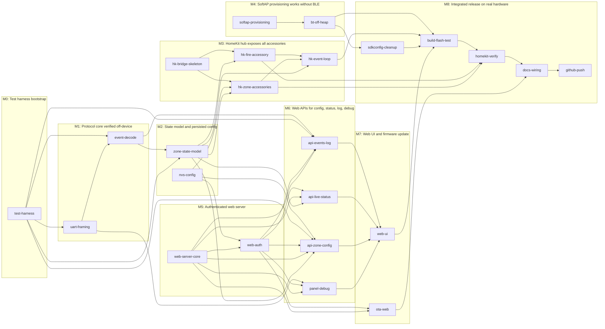

# TODO — Paradox Spectra 1738 → HomeKit hub

Refactor plan: expose the alarm panel as a HomeKit **bridge** with one accessory per zone (1–16) plus a fire alarm accessory, and add an authenticated web server with a SoftAP provisioning access point.

Every milestone lists the work items it contains **and** the tests that must pass before it is considered done. Test IDs are stable — reference them in commits and issue threads.

## Status legend

| Mark | Meaning |
|---|---|
| `[ ]` | not started |
| `[~]` | in progress |
| `[x]` | done |
| `[!]` | blocked |

## Milestones

| # | Milestone | Work items | Tests | Status |
|---|---|---|---|---|
| M0 | Test harness bootstrap | 1 | 4 | [ ] |
| M1 | Protocol core verified off-device | 2 | 6 | [ ] |
| M2 | State model and persisted config | 2 | 6 | [ ] |
| M3 | HomeKit hub exposes all accessories | 4 | 7 | [ ] |
| M4 | SoftAP provisioning works without BLE | 2 | 6 | [ ] |
| M5 | Authenticated web server | 2 | 8 | [ ] |
| M6 | Web APIs for config, status, log, debug | 4 | 8 | [ ] |
| M7 | Web UI and firmware update | 2 | 7 | [ ] |
| M8 | Integrated release on real hardware | 5 | 7 | [ ] |

## Ready to start (no open prerequisites)

- [ ] `hk-bridge-skeleton` — Rebuilding the HomeKit bridge accessory
- [ ] `nvs-config` — Adding NVS-backed configuration store
- [ ] `softap-provisioning` — Switching provisioning to SoftAP
- [ ] `test-harness` — Setting up the test harness
- [ ] `web-server-core` — Adding the embedded web server

## Hard gates

Two tests are stop-the-line risks. Resolve them before building on top of the answer:

- **T4.5 — heap budget for 17 accessories.** If free heap is short on a unicore ESP32, either drop to 8 zones or enable dual-core.
- **T7.7 — OTA size budget.** The current image is ~1.45 MB against 1600 KB `ota_*` partitions; a new partition table may be required.

---

## M0 — Test harness bootstrap

A repeatable way to run tests: host-side Unity unit tests compiled with gcc against the vendored Unity 2.6.0 sources in ESP-IDF, plus a device smoke script and a single make/ci entry point.

### Work items

- [ ] `test-harness` — Setting up the test harness
  Create test/host/ with a Makefile that compiles the vendored Unity 2.6.0 sources from
  /home/nicolas/Source/esp-idf/components/unity/unity/src with gcc for host-side unit tests of
  pure logic (frame decode, state model, config validation, JSON handlers), using
  -fsanitize=address,undefined and optionally thread. Add test/device/smoke.sh for serial boot
  verification, a PARADOX_SIMULATOR build mode that feeds recorded frames instead of UART2, and a
  top-level Makefile "check" target running host tests then idf.py build.

### Validation tests

| # | Test | Kind | How to run | Pass criteria | Status |
|---|---|---|---|---|---|
| T0.1 | Host Unity harness builds and runs | host-unit | Create test/host/ with a Makefile that compiles the vendored Unity 2.6.0 sources from /home/nicolas/Source/esp-idf/components/unity/unity/src plus one trivial suite (test_smoke.c), then run: make -C test/host test | Exit code 0 and the summary line reports "1 Tests, 1 Successes, 0 Failures". No ESP-IDF headers required by the suite. | [ ] |
| T0.2 | Single entry point fails on a broken test | build | Add a top-level Makefile target "check" that runs host tests then idf.py build. Temporarily add an intentionally failing assertion, run make check, then remove it. | make check exits non-zero and names the failing test file and line; after removal it exits 0. | [ ] |
| T0.3 | Device smoke script captures boot log | device | Script test/device/smoke.sh flashes, hard-resets, reads /dev/ttyUSB0 at 115200 for 10 s without asserting DTR/RTS before capture, and greps the log. | Script exits 0 only when it finds "HAP Started" and "Returned from app_main()", and reports zero "Guru Meditation"/"abort()"/"E (" error lines. | [ ] |
| T0.4 | Frame injector / simulator mode exists | device | Add a compile-time PARADOX_SIMULATOR mode that feeds recorded 4-byte frames into the decoder instead of UART2, selectable at runtime from the web debug page or a console command. Build both variants. | Both variants build clean. With simulator enabled and panel disconnected, events still appear in the log at the configured rate; with it disabled, no synthetic events appear. | [ ] |

---

## M1 — Protocol core verified off-device

The Paradox serial stream decodes correctly and self-heals on byte loss, proven by host unit tests with recorded golden frames - no hardware needed to trust the decode layer.

### Work items

- [ ] `event-decode` — Adding the event/category decode layer
  Introduce enums + a decode table for the Spectra 1738 protocol: EventId 1 Zone OK, 2 Zone Open,
  3 Partition Status, 12 Delayed-zone breach, 13 Arm, 15 Disarm, 20 Zone in alarm, 21 Fire alarm,
  22 Zone alarm restore, 23 Fire restore, 24 Special alarm (cat 2 = Fire via keys), 25 Auto zone
  shutdown, 26/27 Zone tamper/restore, 28/29 System trouble/restore. CategoryId 1-16 = zones.
  Produce a decoded event struct with class, zone, and open/closed semantics.
  *Depends on:* `test-harness`, `uart-framing`
- [ ] `uart-framing` — Rewriting the Paradox UART frame decoder
  apps/paradox1738/main/paradox1738.c: replace the current read with a resyncing 4-byte frame
  decoder (the panel stream has no framing header, so a lost byte permanently misaligns reads).
  Check the actual uart_read_bytes return length instead of assuming 4. Remove the unsafe
  ESP_LOGI("%s", (char*)data) on the non-terminated 4-byte buffer (line 27). Define
  paradox1738_deinit() which is declared in paradox1738.h but never implemented. Expose a stats
  counter for framing/overrun errors for the debug endpoint.
  *Depends on:* `test-harness`

### Validation tests

| # | Test | Kind | How to run | Pass criteria | Status |
|---|---|---|---|---|---|
| T1.1 | Golden frame decode table | host-unit | Move the byte-decode logic into a pure function (no driver calls) and unit test it against every EventId in the reference: 1,2,3,5,6-11,12,13,14,15,16,17,18,19,20,21,22,23,24,25,26,27,28,29,30 with representative CategoryIds. Run: make -C test/host test | All vectors decode to the expected EventId, CategoryId and event class. EventId 1 maps to closed, 2 to open, 21 to fire-alarm, 23 to fire-restore. | [ ] |
| T1.2 | CategoryId/EventId bit math matches the reference | host-unit | Feed the documented example bytes and assert EventId = data[0] >> 2 and CategoryId = ((data[0] & 3) << 4) + (data[1] >> 4), including the boundary cases where data[0] low bits are 0b11 and data[1] high nibble is 0xF. | Zone 16 (CategoryId 16) and zone 1 decode correctly; no off-by-one at the 10-bit field boundary; bits 1-4 of the 16-bit field are ignored. | [ ] |
| T1.3 | Decoder resynchronises after a dropped byte | host-unit | Feed a valid frame, then a stream with one byte deleted mid-way, then more valid frames. Assert the error/resync counter and that the decoder returns to aligned output. | After at most one discarded frame the next decoded event matches the expected fixture; framing-error counter increments exactly once per injected corruption; no infinite loop when fewer than 4 bytes remain. | [ ] |
| T1.4 | Short read never produces a phantom event | host-unit | Stub the read to return 0, 1, 2 and 3 bytes and call the decoder. | Each case returns "no event" without touching the caller struct, and no buffer is read past its 4-byte bound (host build uses -fsanitize=address,undefined and reports no errors). | [ ] |
| T1.5 | No unsafe %s logging of the raw buffer | security | grep -n "%s" over the UART sources and run the host decoder under ASAN with a deliberately non-NUL-terminated 4-byte buffer. | Zero %s conversions applied to the UART buffer; frames are logged as hex bytes instead. ASAN reports no overread. | [ ] |
| T1.6 | paradox1738_deinit implemented and idempotent | build | Call paradox1738_deinit() (declared in paradox1738.h but previously undefined) twice from a device test path. | Links without undefined reference; second call returns without crashing or double-freeing the UART driver. | [ ] |

---

## M2 — State model and persisted config

One authoritative, thread-safe state model for zones 1-16 plus fire, and a versioned NVS config that survives reboot and can be edited programmatically.

### Work items

- [ ] `nvs-config` — Adding NVS-backed configuration store
  Persist a config blob in NVS: per-zone enabled flag, HomeKit service type
  (contact/motion/smoke/leak), user-visible name, plus global flags (panel debug on/off, web auth
  hash). Include a schema version with defaults + migration, and a load/save API. Config changes
  require a reboot to rebuild the HomeKit accessory set.
- [ ] `zone-state-model` — Building the central zone/fire state model
  New module holding authoritative state for zones 1-16 plus the fire alarm: open/closed, in-
  alarm, tamper, bypassed, last-change timestamp, and fire alarm/restored. Thread-safe (FreeRTOS
  mutex or queue-based owner task) so the UART reader, HAP loop, and web server can all touch it.
  Single source of truth that HomeKit and the web UI both read.
  *Depends on:* `event-decode`, `test-harness`

### Validation tests

| # | Test | Kind | How to run | Pass criteria | Status |
|---|---|---|---|---|---|
| T2.1 | State model is thread-safe | host-unit | Compile the state module on the host and hammer it from 4 pthreads (2 writers toggling zones, 2 readers snapshotting) for 100k iterations under -fsanitize=thread. | No data-race or deadlock reports; every reader snapshot is internally consistent (no mixed old/new values for one zone). | [ ] |
| T2.2 | Zone index bounds and invalid input rejected | host-unit | Call the setters with zone index 0, 16, 17, -1 and with an unknown event class. | Out-of-range indexes return an error code and leave state untouched; valid range is exactly 1-16. | [ ] |
| T2.3 | State change notifications fire once per real change | host-unit | Send the same "zone open" event twice, then "zone closed". Count observer callbacks. | Exactly two notifications for the two real transitions; the duplicate produces none. | [ ] |
| T2.4 | NVS config round-trip survives reboot | device | Write a non-default config (rename zone 3, set zone 7 type to motion, disable zone 12), reboot the board, read it back over the API or a log dump. | Values after reboot are byte-identical to what was written; untouched zones keep defaults. | [ ] |
| T2.5 | Config schema versioning and migration | device | Flash a build with schema version N, then one with version N+1 that adds a field (or hand-write an old-version blob). Boot the newer build. | Loader detects the version, keeps existing values, fills new fields with documented defaults, and does not wipe the partition; a corrupt blob falls back to defaults and logs a warning. | [ ] |
| T2.6 | Config validation rejects bad values | host-unit | Attempt to set a zone type outside the supported enum, a name longer than the HAP string limit (64 chars), and an empty name. | Each is rejected with an error code; a too-long name is either truncated with a warning or rejected, never silently overflowed. | [ ] |

---

## M3 — HomeKit hub exposes all accessories

The bridge advertises itself plus 16 zone accessories plus the fire accessory in HomeKit, with stable AIDs and correct characteristic updates driven by panel events.

### Work items

- [ ] `hk-bridge-skeleton` — Rebuilding the HomeKit bridge accessory
  apps/paradox1738/main/app_main.c: keep the bridge accessory (HAP_CID_BRIDGE) with product data
  and the Wi-Fi transport service, fix TAG ("HAP motionsensor"), rename the task to something hub-
  specific, and decide the Firmware Upgrade service: either remove it or supply a real server cert
  (currently an empty server_cert at line ~185 makes HomeKit OTA unusable/insecure).
- [ ] `hk-event-loop` — Wiring panel events to HomeKit characteristics
  Replace the commented-out loop at app_main.c ~246-294. Route decoded events by class/zone to the
  right characteristic, cache each char IID at creation time, and fix the old bug where default:
  left new_val uninitialized before hap_char_update_val. Only push updates on actual state change.
  *Depends on:* `hk-fire-accessory`, `hk-zone-accessories`, `zone-state-model`
- [ ] `hk-fire-accessory` — Adding the fire alarm Smoke Sensor accessory
  One bridged accessory with hap_serv_smoke_sensor_create(SMOKE_NOT_DETECTED) driven by EventId 21
  (fire alarm) / 23 (fire restore), plus optional EventId 24 cat 2 (fire via fire keys). Add
  StatusActive, StatusFault and StatusTampered characteristics so a dead smoke loop is visible in
  Home.
  *Depends on:* `hk-bridge-skeleton`, `zone-state-model`
- [ ] `hk-zone-accessories` — Creating 16 bridged zone accessories
  Loop over the config table and for each enabled zone call hap_acc_create + the service chosen by
  type (hap_serv_contact_sensor_create / motion / smoke / leak) + hap_char_name_create(zone name),
  then hap_add_bridged_accessory(accessory, hap_get_unique_aid(name)). All accessories must be
  created before hap_start(). Keep stable AIDs so HomeKit pairings survive firmware updates.
  *Depends on:* `hk-bridge-skeleton`, `nvs-config`, `zone-state-model`

### Validation tests

| # | Test | Kind | How to run | Pass criteria | Status |
|---|---|---|---|---|---|
| T3.1 | Accessory count and types in the HAP database | device | At runtime dump the registered accessories/services (hap_acc_get_first / hap_serv_get_first walk, or GET /api/homekit after M6). Alternatively fetch the HAP /accessories JSON from the paired home over the network. | Exactly 1 bridge + 16 zone accessories + 1 fire accessory. Each zone carries its chosen service type UUID and a Name characteristic matching config; the bridge reports HAP_CID_BRIDGE. | [ ] |
| T3.2 | Pairing succeeds with all accessories present | manual-homekit | Factory-reset the device, pair from the iOS Home app using the printed QR / X-HM URL, then inspect the accessory list. | Pairing completes on the first attempt; Home shows the hub plus 16 zones plus the fire sensor with no "uncertified/unresponsive" entries and no pairing error. | [ ] |
| T3.3 | Stable AIDs across reboot and reflash | device | Record every accessory AID, reboot, record again; then flash a new build and record again. | AID set is identical in all three runs (hap_get_unique_aid derived from a stable per-zone key, not creation order), so Home does not orphan accessories after an update. | [ ] |
| T3.4 | Zone open/close drives ContactSensor.ContactSensorState | device | Inject simulator frames for zone 5 EventId 2 then EventId 1 (or trigger the physical zone) and watch the HAP event/notification log. | ContactSensorState goes 1 (open) then 0 (closed), with an HAP event pushed to subscribed controllers; no other zone changes. | [ ] |
| T3.5 | Alarm, tamper and bypass map to the right characteristics | device | Inject EventId 20 (zone in alarm), 22 (restore), 26/27 (tamper/restore) for a zone and observe HomeKit state plus StatusFault/StatusTampered. | Alarm sets the expected fault/tamper characteristics without ever reporting a false open/close; restore clears them. Uninitialised-value bug from the old default: branch is gone - assert every update path sets a value. | [ ] |
| T3.6 | Fire accessory reacts to EventId 21/23 and 24 cat 2 | device | Inject fire alarm (21), fire restore (23), and special alarm cat 2 (fire keys). Watch SmokeDetected plus StatusActive/StatusFault/StatusTampered. | SmokeDetected goes 1 on 21 and 0 on 23; the keyfob fire path also raises it; StatusFault/StatusTampered stay 0 in the happy path and are settable for the trouble cases. | [ ] |
| T3.7 | No spurious updates and no heap leak over long run | device | Run with simulator frames cycling continuously for at least 2 hours, logging free heap and internal heap minimum every 30 s. | Free heap is flat after warmup (drift under 2 KB per hour); notification queue never overflows; zero HAP error logs. | [ ] |

---

## M4 — SoftAP provisioning works without BLE

The bridge always offers an access point for Wi-Fi credentials, BLE is off, and enough heap remains for 17 accessories.

### Work items

- [ ] `bt-off-heap` — Disabling Bluetooth and measuring heap
  With SoftAP-only provisioning the BLE stack is unnecessary: disable BT/BTDM to reclaim RAM, then
  measure free heap with 17 bridged accessories registered. This is the main feasibility risk for
  a unicore ESP32, so record the numbers before/after.
  *Depends on:* `softap-provisioning`
- [ ] `softap-provisioning` — Switching provisioning to SoftAP
  Set CONFIG_APP_WIFI_PROV_TRANSPORT_SOFTAP (BLE is currently selected) so the device always
  offers an access point for Wi-Fi credentials. Define a predictable AP SSID (e.g. ParadoxBridge-
  XXXX from MAC), keep the QR/URL output, and make the AP come back automatically when stored
  credentials fail so the bridge is never unreachable.

### Validation tests

| # | Test | Kind | How to run | Pass criteria | Status |
|---|---|---|---|---|---|
| T4.1 | SoftAP appears when unprovisioned | device | Factory-reset, power up with no stored credentials, scan Wi-Fi from a phone/laptop. | An AP named per the documented scheme (e.g. ParadoxBridge-`<MAC suffix>`) is visible and open/protected as configured; provisioning endpoint answers on 9090. | [ ] |
| T4.2 | Provisioning over SoftAP joins the network | device | Submit SSID/password through the provisioning API while associated to the device AP, then reboot. | Device connects, gets a DHCP address, and logs "Connected with IP Address". Wrong password produces WIFI_PROV_STA_AUTH_ERROR, retries, and the AP comes back so it is recoverable without reflashing. | [ ] |
| T4.3 | AP returns when saved credentials fail | device | Provision to a nonexistent SSID (or delete the AP), reboot, wait for connection timeout. | SoftAP restarts automatically within the documented timeout; no reboot loop and no watchdog reset. | [ ] |
| T4.4 | Bluetooth fully disabled | build | grep sdkconfig for CONFIG_BT_ENABLED / BT_NIMBLE / BTDM after the change, then check the boot log. | CONFIG_BT_ENABLED=n (and Nimble/BTDM off); boot log contains no wifi_prov_scheme_ble "BT memory released" lines; BLE-only Kconfig warnings are absent. | [ ] |
| T4.5 | Heap budget for 17 accessories | device | With BT off and all 16 zones enabled, log esp_get_free_heap_size() and esp_get_minimum_free_heap_size() immediately after hap_start() and after 10 minutes idle. | Free heap after startup is at least 30 KB with the largest free block at least 8 KB; minimum-free never drops below 15 KB. Record the numbers in the README so the margin is visible. | [ ] |
| T4.6 | Unicore decision justified | build | Compare CONFIG_FREERTOS_UNICORE=y vs n: build both, record binary size, free heap and boot log CPU mode. | One choice is documented with the measured numbers; the chosen config boots cleanly and passes T4.5. | [ ] |

---

## M5 — Authenticated web server

A reachable, authenticated HTTP server on port 80 that coexists with HAP (8080) and provisioning (9090) and never leaks credentials.

### Work items

- [ ] `web-auth` — Adding authentication to the web server
  The web UI can change Wi-Fi credentials and zone config, so it must not be open: token/cookie
  session with a login password stored as a hash in NVS, CSRF or same-origin check for mutating
  routes, and no plaintext credential logging (the existing app_wifi.c:192-195 logs the Wi-Fi
  password - remove that).
  *Depends on:* `nvs-config`, `web-server-core`
- [ ] `web-server-core` — Adding the embedded web server
  esp_http_server instance on port 80 (HAP core owns 8080, wifi_prov SoftAP endpoint owns 9090 -
  verify no clash). Serve a small static UI from LittleFS/SPIFFS or embedded binary data, plus
  JSON API routes under /api/. Add a config option to disable the server entirely.

### Validation tests

| # | Test | Kind | How to run | Pass criteria | Status |
|---|---|---|---|---|---|
| T5.1 | Server reachable on 80 alongside HAP 8080 and prov 9090 | device | netstat/ss on the host is not applicable, so probe from a laptop: curl http://`<ip>`/ , http://`<ip>`:8080/accessories (HAP), and 9090 during provisioning. | All three respond on their own port with no bind conflict; boot log shows no httpd "Failed to bind" error. | [ ] |
| T5.2 | Unauthenticated requests are rejected | security | With auth enabled, curl every mutating route (POST/PUT/DELETE) and the config/status reads without a session cookie. | Mutating routes return 401/403; no config change occurs (verified by re-reading). Only explicitly public routes (login, static assets, optional status) answer. | [ ] |
| T5.3 | Session token is not guessable and expires | security | Log in, capture the cookie, check its length/entropy and that it is HttpOnly + SameSite; wait past the TTL and retry. | Token is at least 128 bits of randomness, HttpOnly and SameSite=Strict/Lax; expired or forged tokens are rejected; logout invalidates the token server-side. | [ ] |
| T5.4 | Password stored only as a salted hash | security | Dump the NVS config blob (or read it through the API) and grep the whole image: strings build/paradox1738.bin \| grep -i `<password>`. | The plaintext password appears nowhere in NVS or the binary; only the hash and salt are stored. Changing the password updates both. | [ ] |
| T5.5 | Wi-Fi credentials never logged in plaintext | security | grep -n over app_wifi.c and the web layer for logging of the proof/pass, then provision a network with a known sentinel password and capture the full serial log. | The sentinel password never appears in the serial log or any HTTP response; the existing plaintext log at apps/common/app_wifi/app_wifi.c:192-195 is removed or masked. | [ ] |
| T5.6 | CSRF / same-origin protection on mutating routes | security | Send a POST with Origin/Referer from a foreign host and no CSRF token, using a valid session cookie. | Rejected with 403 and no state change; the same request with the correct token succeeds. | [ ] |
| T5.7 | Path traversal and oversized bodies blocked | security | Request /../../etc/config style paths and POST an oversized JSON body (over the documented limit) and malformed JSON. | Traversal returns 404/400 without serving files; oversized bodies are refused with 413; malformed JSON returns 400 and leaves config untouched. | [ ] |
| T5.8 | Web server can be disabled by config | build | Set the disable option, rebuild, probe port 80. | Port 80 is closed and no httpd task is created; HAP on 8080 still works. | [ ] |

---

## M6 — Web APIs for config, status, log, debug

JSON APIs that read/write zone config, stream live state, expose the event log, and show raw panel frames for protocol work.

### Work items

- [ ] `api-events-log` — Adding the panel event log
  RAM ring buffer (sized in config) of decoded events with timestamps, exposed at GET /api/events
  with class/zone filters and a clear action. Optionally persist the last N events to NVS so they
  survive a reboot for troubleshooting.
  *Depends on:* `event-decode`, `test-harness`, `web-auth`, `web-server-core`
- [ ] `api-live-status` — Adding live status endpoint and event stream
  GET /api/status returns all zone + fire states as JSON with timestamps, and an SSE (or long-
  poll) stream pushes state changes so the UI updates without polling. Back it off the state model
  change notifications rather than the UART task directly.
  *Depends on:* `web-auth`, `web-server-core`, `zone-state-model`
- [ ] `api-zone-config` — Adding the zone configuration API
  GET /api/zones returns the 16 zone configs plus current state; PUT /api/zones/{n} updates
  name/type/enabled and writes NVS, then reports that a reboot is required to apply to HomeKit.
  Validate type against the supported enum and reject out-of-range indexes.
  *Depends on:* `nvs-config`, `test-harness`, `web-auth`, `web-server-core`, `zone-state-model`
- [ ] `panel-debug` — Adding the raw panel debug view
  Debug endpoint streaming raw 4-byte frames as hex with decoded interpretation side by side, plus
  UART error/framing counters, so protocol work can continue from a browser without a serial
  cable. Gate it behind the debug config flag and auth.
  *Depends on:* `uart-framing`, `web-auth`, `web-server-core`

### Validation tests

| # | Test | Kind | How to run | Pass criteria | Status |
|---|---|---|---|---|---|
| T6.1 | GET /api/zones returns all 16 zones with state | device | curl the endpoint after login and validate the JSON against a schema (host script with python jsonschema). | Exactly 16 entries, indexes 1-16, each with name, type, enabled and live state fields; JSON validates against the published schema; response under 8 KB so it fits one httpd buffer. | [ ] |
| T6.2 | PUT /api/zones/{n} persists and reports pending reboot | device | Rename zone 3 and change zone 7 to motion via PUT, re-read, reboot, re-read. | PUT returns success plus an explicit "reboot required for HomeKit" flag; the change is present immediately in the API and after reboot; HomeKit names/types only change after the reboot. | [ ] |
| T6.3 | Invalid zone edits are rejected atomically | host-unit | Unit test the request handler with: index 0/17, unknown type, over-long name, truncated JSON body. | Each returns 4xx with an error message and no partial write to NVS (verified by re-reading all fields). | [ ] |
| T6.4 | Live status stream pushes changes within 2 s | device | Open the SSE stream from a laptop, inject a zone-open frame, measure the delay to the pushed event. | Event arrives within 2 s of injection; stream stays open for at least 5 minutes without reconnect; disconnecting the client does not leak a session (client count returns to 0). | [ ] |
| T6.5 | Status endpoint matches HomeKit state | device | Compare GET /api/status against the HAP /accessories values for the same zones after the same injected frames. | No disagreement on any zone: open/closed, alarm, tamper and fire all match between the web view and HomeKit. | [ ] |
| T6.6 | Event log ring buffer behaves under load | host-unit | Push more events than the buffer holds and read it back; also test the clear action and class/zone filters. | Returns exactly the most recent N events in newest-first order, no gaps or duplicates; filters work; clear empties it; no allocation growth after 10k pushes. | [ ] |
| T6.7 | Panel debug shows raw hex plus decode side by side | device | Inject a known frame with debug enabled and read the debug endpoint. | Raw bytes shown as hex (never as a string), decoded EventId/CategoryId/class shown next to them, and UART framing/overrun counters are present and increment on injected corruption. | [ ] |
| T6.8 | Debug endpoints require the debug flag | security | Call the debug routes with the flag off, then on. | Off: 404 or 403 with no frame data leaked. On: data served, and only to an authenticated session. | [ ] |

---

## M7 — Web UI and firmware update

A phone-usable single-page UI covering setup, zones, live status, logs and debug, plus a safe web OTA with rollback.

### Work items

- [ ] `ota-web` — Adding web-based firmware update
  Upload endpoint using esp_ota_ops writing the inactive slot, verify image, set boot partition,
  reboot; guard against exceeding the 1600K ota partitions (current build is ~1.45MB so headroom
  is thin). Add a rollback/boot-validity check and show running version + slot in the UI.
  *Depends on:* `web-auth`, `web-server-core`
- [ ] `web-ui` — Building the single-page web UI
  Plain HTML/CSS/JS (no build chain) with tabs: Wi-Fi/provisioning status, zone list with editable
  name/type/enabled, live status dashboard showing all 16 zones + fire, event log, and panel
  debug. Must work on a phone since setup happens next to the alarm panel.
  *Depends on:* `api-events-log`, `api-live-status`, `api-zone-config`, `panel-debug`

### Validation tests

| # | Test | Kind | How to run | Pass criteria | Status |
|---|---|---|---|---|---|
| T7.1 | UI loads on a phone over the SoftAP network | manual | Provision from a phone connected to the device AP, open http://`<gateway>`/ in Safari. | Page renders without external CDN assets (fully offline), all tabs reachable, controls usable at 390 px width. | [ ] |
| T7.2 | Zone config round-trips through the UI | manual | Rename two zones, change one type, disable one, save, reboot, reload the page. | All edits are shown after reboot; disabled zone disappears from HomeKit on the next pairing/refresh; no JS console errors during the flow. | [ ] |
| T7.3 | Live dashboard reflects physical triggers | manual | Open the dashboard, then open and close a real zone on the alarm panel. | Tile flips within 2 s with a timestamp; fire tile stays clear during a normal zone test. | [ ] |
| T7.4 | OTA upload flashes the inactive slot and boots it | device | Build a versioned image, upload through the web UI, watch the log, then reboot. | esp_ota writes the inactive slot, image validation passes, boot partition flips, the new version reports itself in the UI and boot log; the previous slot remains intact for rollback. | [ ] |
| T7.5 | Oversized or corrupt firmware is refused | device | Upload a truncated image, a wrong-arch image, and an image larger than the ota partition. | All three rejected with a clear error before the boot partition changes; the device still boots the old firmware; no bricked state. | [ ] |
| T7.6 | Rollback on a bad update | device | Upload an image that boots but crashes before reporting validity, then power-cycle. | Bootloader or esp_ota_ops roll back to the previous slot (CONFIG_BOOTLOADER_APP_ROLLBACK_ENABLE) and the device is reachable again without reflashing. | [ ] |
| T7.7 | OTA size budget respected | build | Record idf.py size output and the .bin size against the 1600K partition after adding the web server and UI assets. | paradox1738.bin stays under 1500 KB (at least 100 KB headroom); if not, either shrink UI assets or propose a new partition table in the docs before merging. | [ ] |

---

## M8 — Integrated release on real hardware

The whole stack flashed to the board, verified in Apple Home with physical zone triggers, within size/heap budgets, documented and pushed.

### Work items

- [ ] `build-flash-test` — Building, flashing and monitoring on the board
  Build against ESP-IDF v5.5.6 and flash to /dev/ttyUSB0 (CP2102, ESP32-D0WDQ6 rev v1.0, MAC
  84:cc:a8:69:b4:4c). The chip currently runs a 2023 v5.1-dev build that is already paired in
  HomeKit and provisioned to SSID APO, so confirm whether to preserve or factory-reset that
  pairing before flashing.
  *Depends on:* `bt-off-heap`, `hk-event-loop`, `sdkconfig-cleanup`, `web-ui`
- [ ] `docs-wiring` — Documenting wiring, protocol and usage
  Update README with the SoftAP setup flow, web UI URL/port map, zone config, OTA, and the
  hardware note that panel TX may be 5V while the ESP32 is 3.3V (level shifting / series resistor
  needed on GPIO16), plus UART2 GPIO17 TX / GPIO16 RX at 9600.
  *Depends on:* `homekit-verify`, `ota-web`
- [ ] `github-push` — Committing and pushing the work
  Commit each completed phase to main and push to https://github.com/nplourde/esp-homekit-
  paradox1738.git with the Co-authored-by trailer.
  *Depends on:* `docs-wiring`
- [ ] `homekit-verify` — Verifying the bridge in Apple Home
  Pair the bridge, confirm the hub plus 16 zone accessories plus the fire accessory appear with
  correct names/types, then trigger zones physically on the panel and verify
  open/close/alarm/tamper and fire alarm/restore all update. Document any EventId that does not
  decode as expected.
  *Depends on:* `build-flash-test`, `hk-fire-accessory`, `hk-zone-accessories`
- [ ] `sdkconfig-cleanup` — Reviewing sdkconfig.defaults for IDF 5.5.6
  Audit the defaults now that the project builds on v5.5.6: BT off, provisioning transport,
  unicore choice vs the dual-core chip, task WDT naming, httpd/LWIP socket counts sized for the
  web server plus HAP sessions, and remove any further dead options.
  *Depends on:* `bt-off-heap`

### Validation tests

| # | Test | Kind | How to run | Pass criteria | Status |
|---|---|---|---|---|---|
| T8.1 | Full regression gate is green | build | Run make check: host unit tests, then idf.py build for esp32 with the release sdkconfig.defaults. | Zero compiler warnings from project sources (-Werror on project code), zero failing host tests, build succeeds and prints the size table. | [ ] |
| T8.2 | Clean boot on the board, no runtime errors | device | test/device/smoke.sh against /dev/ttyUSB0 after a full flash. | Boot log reaches "HAP Started" with 17 accessories registered, no Guru Meditation, no stack overflow, no watchdog reset over 5 minutes. | [ ] |
| T8.3 | Real HomeKit acceptance with physical zones | manual-homekit | Pair fresh in Apple Home, then walk the house: open/close each wired zone, trip a smoke detector, press a fire keyfob if available. | Every zone appears and updates correctly in Home; the fire accessory alarms on the smoke loop and clears on restore; no accessory drops off the bridge during the walkthrough. | [ ] |
| T8.4 | 24-hour soak with the panel attached | device | Run the real build connected to the live panel for 24 h, logging heap, min-heap, framing errors and HAP errors every minute. | No reset, no crash, no heap decline beyond 5 KB over the run, framing error count stable (no permanent desync), HomeKit stays reachable. | [ ] |
| T8.5 | Recovery paths verified | manual | Force each failure: wrong Wi-Fi password, router off, panel UART unplugged, panel UART shorted to 5 V. | Device recovers on its own in every case (SoftAP returns, decoder resyncs, no crash) and is reachable through the web UI without reflashing. | [ ] |
| T8.6 | Docs match reality | manual | Follow README from a clean clone on a second machine: clone --recurse-submodules, install.sh, export.sh, build, flash, provision, open the UI. | Every documented step works verbatim; IDF version, port map (80/8080/9090), zone config, OTA and the 5 V level-shifting warning for GPIO16 are all present and correct. | [ ] |
| T8.7 | Release tagged and pushed | build | git log/status check, push main plus a v0.1.0 tag to https://github.com/nplourde/esp-homekit-paradox1738.git. | Working tree clean, remote main matches local HEAD, tag exists on the remote, submodule pointer still resolves from a fresh clone. | [ ] |

---

## Dependency graph

Arrows point from a prerequisite to the work item that needs it. Items with no incoming arrow can start immediately.

---

## Test index

| Kind | Count | What it needs |
|---|---|---|
| build | 8 | idf.py build / sdkconfig inspection only |
| device | 25 | board on `/dev/ttyUSB0` + serial capture |
| host-unit | 11 | host toolchain only (`make -C test/host test`) — no hardware |
| manual | 5 | a phone on the bridge network |
| manual-homekit | 2 | iPhone with the Home app and a paired bridge |
| security | 8 | board + `curl`, plus a `strings` scan of the image |

