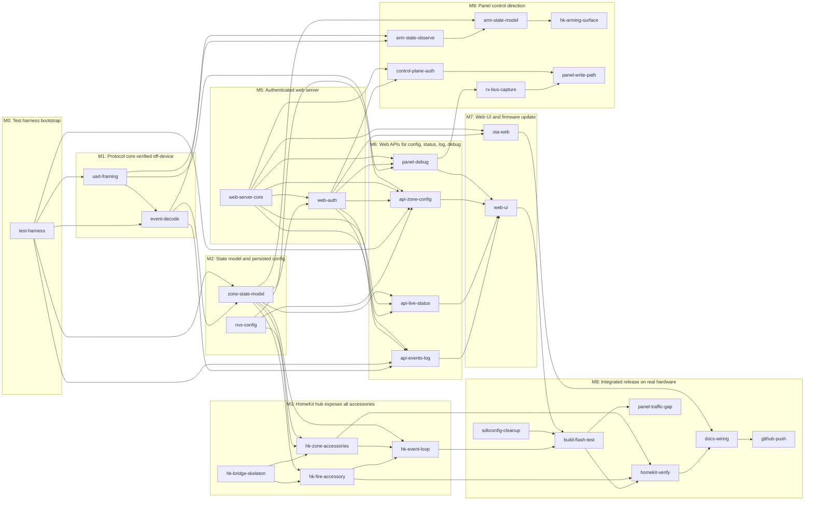

# TODO — Paradox Spectra 1738 → HomeKit hub

Refactor plan: expose the alarm panel as a HomeKit **bridge** with one accessory per zone (1–16) plus a fire alarm accessory, and add an authenticated web server. Wi-Fi setup remains on ESP-IDF's stock unified provisioning flow over BLE; a project-specific SoftAP flow is out of scope.

Every milestone lists the work items it contains **and** the tests that must pass before it is considered done. Test IDs are stable — reference them in commits and issue threads.

## Status legend

| Mark | Meaning |
|---|---|
| `[ ]` | not started |
| `[~]` | in progress |
| `[x]` | done |
| `[!]` | blocked |
| `[-]` | removed from scope |

## Milestones

| # | Milestone | Work items | Tests | Status |
|---|---|---|---|---|
| M0 | Test harness bootstrap | 1 | 4 | [x] |
| M1 | Protocol core verified off-device | 2 | 6 | [x] |
| M2 | State model and persisted config | 2 | 6 | [x] |
| M3 | HomeKit hub exposes all accessories | 4 | 7 | [~] |
| M4 | Custom SoftAP provisioning (dropped; keep stock ESP-IDF BLE) | 0 | 6 | [-] |
| M5 | Authenticated web server | 2 | 9 | [~] |
| M6 | Web APIs for config, status, log, debug | 4 | 8 | [x] |
| M7 | Web UI and firmware update | 3 | 9 | [x] |
| M8 | Integrated release on real hardware | 5 | 7 | [~] |
| M9 | Panel control direction - observe, capture, then write | 7 | 7 | [~] |

## Ready to start (no open prerequisites)

The three items this section used to list - `hk-bridge-skeleton`, `nvs-config`, `uart-framing` -
finished long ago (M3, M2, M1); the list had simply gone stale and said otherwise. What is
open and can genuinely start with nothing waiting on it:

- [ ] `arm_state_observe` (M9) - one keypad arm and one disarm; sends no bytes out
- [ ] `control_plane_auth` (M9) - half built now (the command record); the credential halves
  are code work, and must land before any TX code does
- [ ] `audit_trail_persistence` (M9) - code work: the command record is RAM-only, so the
  bridge restart control wipes it along with every reboot, OTA and power cut
- [ ] `power-cycle` (M8) - needs someone at the wall socket
- Partial, waiting on a person rather than on code: `docs-wiring` (M8), `homekit-verify` (M8),
  T3.5 bypass in Home, T3.6 StatusActive/StatusTampered
- [ ] `panel-level-measurement` (M8, was T8.5 as written) - needs a multimeter at the panel, ten
  minutes, no risk: idle voltage on the panel TX wire, then the reading while the panel transmits.
  The table in `docs/WIRING.md` turns the number into the level-interface decision. The old version
  of this test forced the UART line to 5 V, which is a way to destroy the board
- [ ] `sentinel-provisioning` (M5, the last half of T5.5) - needs whoever holds the house Wi-Fi key:
  provisioning the bench board with a throwaway network overwrites its stored credentials, and only
  the real key puts it back. The procedure is in the T5.5 row

## Hard gates

Two gates stop the line. Resolve each before building on top of its answer:

- **T7.7 — OTA size budget.** Passed: the M7 image is 1,389,344 bytes, under the 1500 KiB target; no partition-table change is needed.
- **T9.5 gates T9.7 — nothing writes to a live intrusion panel on a guess.** No byte goes out on the panel's command line until captured keypad frames decode into named fields in a host test (T9.5), the credential work (T9.6) passes, and the write experiment runs on a bench panel or with the protected panel disconnected from service.

---

## M0 — Test harness bootstrap

A repeatable way to run tests: host-side Unity unit tests compiled with gcc against the vendored Unity 2.6.0 sources in ESP-IDF, plus a device smoke script and a single make/ci entry point.

### Work items

- [x] `test-harness` — Setting up the test harness
  Create test/host/ with a Makefile that compiles the vendored Unity 2.6.0 sources from
  /home/nicolas/Source/esp-idf/components/unity/unity/src with gcc for host-side unit tests of
  pure logic (frame decode, state model, config validation, JSON handlers), using
  -fsanitize=address,undefined and optionally thread. Add test/device/smoke.sh for serial boot
  verification, a PARADOX_SIMULATOR build mode that feeds recorded frames instead of UART2, and a
  top-level Makefile "check" target running host tests then idf.py build.

### Validation tests

| # | Test | Kind | How to run | Pass criteria | Status |
|---|---|---|---|---|---|
| T0.1 | Host Unity harness builds and runs | host-unit | make -C test/host check. Compiles the vendored Unity 2.6.0 sources from $IDF_PATH/components/unity/unity/src plus test_smoke.c with plain gcc and runs the binary. | Exit code 0 and Unity prints its summary line "N Tests F Failures I Ignored" followed by OK. No ESP-IDF headers in the suite (UNITY_INCLUDE_CONFIG_H deliberately left undefined, since IDF's unity_config.h pulls in esp_err.h/sdkconfig.h). | [x] |
| T0.2 | Single entry point fails on a broken test | build | make check-fail builds test/host/samples/deliberate_failure.c (asserts 1 == 2) and runs it, asserting non-zero exit AND that the output names deliberate_failure.c:`<line>`. make check runs host tests, the smoke analyzer self-test, then both device builds. | make check-fail exits 0 only when the deliberate failure is reported with file and line and a non-zero status; make check exits 0 on a clean tree. | [x] |
| T0.3 | Device smoke script captures boot log | device | test/device/smoke.sh (no --flash by default): opens the port, de-asserts DTR/RTS, pulses RTS to hard-reset EN, then reads for --seconds (default 10) at 115200 and analyses the log. --self-test exercises the analyzer on synthetic healthy/crashing/truncated/error logs with no hardware. make smoke FLASH=1 adds idf.py flash first. | Exits 0 only when "HAP Started" and "Returned from app_main()" are both present and there are zero crash markers (Guru Meditation, abort(), Stack canary, LoadProhibited, ...) and zero ESP-IDF error-level lines ("E (n) tag:"). --self-test exits 0 with all five analyzer cases correct. | [x] |
| T0.4 | Frame injector / simulator mode exists | device | make build (simulator off) and make build-sim (CONFIG_PARADOX_SIMULATOR=y via apps/paradox1738/sdkconfig.simulator.defaults, separate -B build-sim and -D SDKCONFIG=sdkconfig.simulator). Compare xtensa-esp32-elf-strings of the two binaries. | Both variants build clean. Simulator binary contains "SIM event" and the "simulator enabled: UART2 not initialised" warning and no "Recv str"; default binary contains "Recv str" and no simulator strings. Runtime web-page/console toggle deferred to M5 when the web server exists. | [x] |

---

## M1 — Protocol core verified off-device

The Paradox serial stream decodes correctly and self-heals on byte loss, proven by host unit tests with recorded golden frames - no hardware needed to trust the decode layer.

### Work items

- [x] `event-decode` — Adding the event/category decode layer
  Introduce enums + a decode table for the Spectra 1738 protocol: EventId 0 Zone OK, 1 Zone Open,
  2 Partition Status, 12 Delayed-zone breach, 13 Arm, 15 Disarm, 20 Zone in alarm, 21 Fire alarm,
  22 Zone alarm restore, 23 Fire restore, 24 Special alarm (cat 2 = Fire via keys), 25 Auto zone
  shutdown, 26/27 Zone tamper/restore, 28/29 System trouble/restore. CategoryId 1-16 = zones.
  Produce a decoded event struct with class, zone, and open/closed semantics.
  Note: the first three ids come from the reference implementation's *source* table
  (`Program.cs`), not its README table, which is shifted by one for those ids. Ids 3 and 4
  are never emitted. Confirmed against a live raw UART capture (M6 status notes).
  *Depends on:* `test-harness`, `uart-framing`
- [x] `uart-framing` — Rewriting the Paradox UART frame decoder
  apps/paradox1738/main/paradox1738.c: replace the current read with a resyncing 4-byte frame
  decoder (the panel stream has no framing header, so a lost byte permanently misaligns reads).
  Check the actual uart_read_bytes return length instead of assuming 4. Remove the unsafe
  ESP_LOGI("%s", (char*)data) on the non-terminated 4-byte buffer (line 27). Define
  paradox1738_deinit() which is declared in paradox1738.h but never implemented. Expose a stats
  counter for framing/overrun errors for the debug endpoint.
  *Depends on:* `test-harness`

### Validation tests

| # | Test | Kind | How to run | Pass criteria | Status |
|---|---|---|---|---|---|
| T1.1 | Golden frame decode table | host-unit | Move the byte-decode logic into a pure function (no driver calls) and unit test it against every EventId in the reference: 0,1,2,5,6-11,12,13,14,15,16,17,18,19,20,21,22,23,24,25,26,27,28,29,30 with representative CategoryIds. Run: make -C test/host test | All vectors decode to the expected EventId, CategoryId and event class. EventId 0 maps to closed, 1 to open, 21 to fire-alarm, 23 to fire-restore. Decode lives in `main/paradox_proto.c`; covered by `test/host/test_decode.c` (9 tests) plus `test_simframes.c`, which replays the whole recorded simulator table through the real decoder. A proposed renumbering that moved Partition Status from 2 to 3 was tried and rejected: it breaks the idle-panel broadcast replay (`test_idle_panel_broadcast_decodes_cleanly`) and the never-used-id guard, so the 0/1/2 numbering with ids 3 and 4 unused stands. | [x] Live-panel confirmation (192.168.4.30, live Spectra 1738): the idle quartets decode as `04219200` -> event 1 category 2 "Zone Open", `00219200` -> event 0 category 2 "Zone OK", `08019200`/`08119200` -> event 2 categories 0/1 "Partition Status", and ids 3 and 4 never appear in 9057 frames. Renumbering Partition Status to 3 breaks that capture, so 0/1/2 is now confirmed twice - once by the bench capture, once by the live panel.|
| T1.2 | CategoryId/EventId bit math matches the reference | host-unit | Feed the documented example bytes and assert EventId = data[0] >> 2 and CategoryId = ((data[0] & 3) << 4) + (data[1] >> 4), including the boundary cases where data[0] low bits are 0b11 and data[1] high nibble is 0xF. | Zone 16 (CategoryId 16) and zone 1 decode correctly; no off-by-one at the 10-bit field boundary; bits 1-4 of the 16-bit field are ignored. | [x] |
| T1.3 | Decoder resynchronises after a dropped byte | host-unit | Feed a valid frame, then a stream with one byte deleted mid-way, then more valid frames. Assert the error/resync counter and that the decoder returns to aligned output. | After at most one discarded frame the next decoded event matches the expected fixture; framing-error counter increments exactly once per injected corruption; no infinite loop when fewer than 4 bytes remain. | [x] |
| T1.4 | Short read never produces a phantom event | host-unit | Stub the read to return 0, 1, 2 and 3 bytes and call the decoder. | Each case returns "no event" without touching the caller struct, and no buffer is read past its 4-byte bound (host build uses -fsanitize=address,undefined and reports no errors). | [x] |
| T1.5 | No unsafe %s logging of the raw buffer | security | grep -n "%s" over the UART sources and run the host decoder under ASAN with a deliberately non-NUL-terminated 4-byte buffer. | Zero %s conversions applied to the UART buffer; frames are logged as hex bytes instead. ASAN reports no overread. | [x] |
| T1.6 | paradox1738_deinit implemented and idempotent | build | Call paradox1738_deinit() (declared in paradox1738.h but previously undefined) twice from a device test path. `make build-selftest` builds with `CONFIG_PARADOX_LINK_SELFTEST=y` (via `sdkconfig.selftest.defaults`, separate `-B build-selftest`); app_main() then runs `paradox1738_link_selftest()`, which inits, calls deinit twice and re-inits. Flashed to `/dev/ttyUSB0`; boot log showed `LINK SELFTEST: PASS (deinit implemented and idempotent)`. | Links without undefined reference; second call returns without crashing or double-freeing the UART driver. | [x] |

---

## M2 — State model and persisted config

One authoritative, thread-safe state model for zones 1-16 plus fire, and a versioned NVS config that survives reboot and can be edited programmatically.

### Work items

- [x] `nvs-config` — Adding NVS-backed configuration store
  Persist a config blob in NVS: per-zone enabled flag, HomeKit service type
  (contact/motion/smoke/leak), user-visible name, plus global flags (panel debug on/off, web auth
  hash). Schema v1 uses a stable byte encoding; v0 migrates by defaulting the new auth hash.
  Defaults enable all zones as contact sensors named "Zone 1" through "Zone 16". The NVS load/save
  API validates values and falls back with a warning for corrupt or unsupported blobs. Config
  changes require a reboot to rebuild the HomeKit accessory set.
- [x] `zone-state-model` — Building the central zone/fire state model
  New module holding authoritative state for zones 1-16 plus the fire alarm: open/closed, in-
  alarm, tamper, bypassed, last-change timestamp, and fire alarm/restored. Thread-safe (FreeRTOS
  mutex on device; pthread mutex on host) with atomic snapshots and callbacks only on real changes.
  UART/HAP/web integrations consume this shared API in their respective milestones.
  *Depends on:* `event-decode`, `test-harness`

### Validation tests

| # | Test | Kind | How to run | Pass criteria | Status |
|---|---|---|---|---|---|
| T2.1 | State model is thread-safe | host-unit | `make -C test/host check SAN=thread CC=gcc-16`; 2 pthread writers each toggle one zone 100k times while 2 readers snapshot. | No data-race or deadlock reports; snapshots preserve the zone/open/timestamp invariants. | [x] |
| T2.2 | Zone index bounds and invalid input rejected | host-unit | `test/host/test_state.c` exercises indexes 0, 16, 17, -1, an out-of-range fire category, and an unknown event class. | Out-of-range indexes return an error code and leave state untouched; valid zone range is exactly 1-16. | [x] |
| T2.3 | State change notifications fire once per real change | host-unit | Send zone-open twice, then zone-closed; count observer callbacks. | Exactly two notifications for the two real transitions; the duplicate produces none. | [x] |
| T2.4 | NVS config round-trip survives reboot | device | `make build-configtest`, flash it, then capture boot with `test/device/smoke.sh --port /dev/ttyUSB0 --seconds 45 --allow-errors`. Isolated `pconfig_test` namespace writes Zone 3 name, Zone 7 motion type and disables Zone 12; the test reboots and verifies every field and all untouched defaults. | Boot log reports `CONFIG SELFTEST: PASS`; production `paradox` namespace is not modified. | [x] |
| T2.5 | Config schema versioning and migration | device | Same isolated device self-test writes a v0 blob, reboots into the v1 loader, then tests a corrupt blob on another reboot. | Migration preserves configured fields and defaults the new hash; corrupt data logs a warning and falls back to defaults without erasing NVS. Device log reports `CONFIG SELFTEST: PASS`. | [x] |
| T2.6 | Config validation rejects bad values | host-unit | `make -C test/host check` runs `test_config.c` with invalid service type, a 65-character name and an empty name. | Each invalid value is rejected with an explicit result; valid 64-character names fit without overflow. | [x] |

---

## M3 — HomeKit hub exposes all accessories

The bridge advertises itself plus 16 zone accessories plus the fire accessory in HomeKit, with stable AIDs and correct characteristic updates driven by panel events.

### Work items

- [x] `hk-bridge-skeleton` — Rebuilding the HomeKit bridge accessory
  `apps/paradox1738/main/app_main.c` registers the bridge with product data and Wi-Fi transport.
  The unusable firmware-upgrade service with an empty server certificate was removed, and the task
  and log tag now use hub-specific names.
- [x] `hk-event-loop` — Wiring panel events to HomeKit characteristics
  The app reads decoded panel events, applies them to the shared state model, and updates the
  corresponding HomeKit characteristics through a state observer. Repeated state values do not
  produce notifications; invalid state updates are logged.
  *Depends on:* `hk-fire-accessory`, `hk-zone-accessories`, `zone-state-model`
- [x] `hk-fire-accessory` — Adding the fire alarm Smoke Sensor accessory
  A bridged smoke sensor exposes SmokeDetected, StatusActive, StatusFault, and StatusTampered.
  SmokeDetected follows EventId 21/23 and EventId 24/category 2; StatusFault follows fire-loop
  trouble and restore (EventId 28/29, category 7). No independent fire-loop tamper event is
  currently modeled, so StatusTampered remains clear.
  *Depends on:* `hk-bridge-skeleton`, `zone-state-model`
- [x] `hk-zone-accessories` — Creating 16 bridged zone accessories
  Before `hap_start()`, the app creates an accessory for each enabled zone using its configured
  name and contact, motion, smoke, or leak service. Alarm/bypass updates StatusFault, tamper updates
  StatusTampered, and AIDs use stable zone-number identifiers rather than names.
  *Depends on:* `hk-bridge-skeleton`, `nvs-config`, `zone-state-model`

### Validation tests

Host tests, production and simulator builds, and the boot-log analyzer passed.
The attached board was factory-reset and flashed with the M3 image. It boots
without crash/error logs and reports 18 accessories (bridge, 16 zones, fire)
with the expected service UUIDs. All 18 AID/name pairs matched after reboot and
reflash without erasing NVS. The user confirmed Apple Home pairing and accessory
visibility, later removed the bridge, and has now paired it again with the
production image. The production image was rebuilt and reflashed without
erasing NVS and passed the 20-second boot smoke test. A 120-second simulator run
exercised zone, alarm, tamper, bypass, fire, and fire-loop-trouble state changes
and logged HAP value changes. A
two-hour simulator soak captured 226 heap samples over 119.45 minutes. After
the initial warmup, internal free heap rose by 632 bytes (about 322 bytes/hour),
and minimum free heap remained 135604 bytes. The normalized full log passed the
boot/crash/error analyzer with no issues. The monitor was stopped at the
two-hour timeout; its captured log continued past two hours of device uptime.
In a later 90-second simulator run, the paired controller completed Pair Verify
twice; the user observed Zone 1 change to open in Apple Home while the simulator
reported that state change and HAP value-change output. This confirms at least
one controller-visible characteristic update. The user then confirmed seeing
all zone sensors and the fire detector transition open/alarm and return to
closed/clear one by one in Home. Production firmware was restored without
erasing NVS and passed the boot smoke test. A focused Zone 1-only simulator
replay emitted alarm/restore, tamper/restore, and open/close events without
bypass or events for other accessories. The user confirmed in Home that Zone 1
alarm/fault and tamper indicators each set and cleared, the contact state
opened and closed, and no other zones changed. The device log showed
subscriptions and HAP notification sends; the captured HomeKit session later
disconnected. Production firmware was restored without erasing NVS and passed
the boot smoke test. A separate fire-loop retest showed StatusFault changing
in Home; StatusActive and fire StatusTampered have not been independently
checked.

| # | Test | Kind | How to run | Pass criteria | Status |
|---|---|---|---|---|---|
| T3.1 | Accessory count and types in the HAP database | device | At runtime dump the registered accessories/services (hap_acc_get_first / hap_serv_get_first walk, or GET /api/homekit after M6). Alternatively fetch the HAP /accessories JSON from the paired home over the network. | With default config, exactly 1 bridge + 16 zone accessories + 1 fire accessory. Each enabled zone carries its chosen service type UUID and a Name characteristic matching config; the bridge reports HAP_CID_BRIDGE. | [x] |
| T3.2 | Pairing succeeds with all accessories present | manual-homekit | Factory-reset the device, provision Wi-Fi, pair from the iOS Home app using the printed QR / X-HM URL, then inspect the accessory list. | Pairing completes on the first attempt; Home shows the hub plus 16 zones plus the fire sensor with no "uncertified/unresponsive" entries and no pairing error. | [x] |
| T3.3 | Stable AIDs across reboot and reflash | device | Record every accessory AID, reboot, record again; then flash a new build and record again. | AID set is identical in all three runs (hap_get_unique_aid derived from a stable per-zone key, not creation order), so Home does not orphan accessories after an update. | [x] |
| T3.4 | Zone open/close drives ContactSensor.ContactSensorState | device | Inject simulator frames for zone EventId 1 then EventId 0 (or trigger the physical zone) and watch Home plus the HAP event/notification log. | Zone sensors visibly transition open then closed in Home with no unrelated zone change. | [x] |
| T3.5 | Alarm, tamper and bypass map to the right characteristics | device | Inject Zone 1 EventId 20/22 and 26/27 without bypass; observe HomeKit plus StatusFault/StatusTampered. | Alarm sets and restore clears StatusFault; tamper sets and restore clears StatusTampered; no unrelated zone changes. Alarm/tamper pass; bypass remains unverified in Home. The recorded replay on the live module (`POST /api/debug/simulator`, status polled at 16 Hz) pins all three on the device clock in one run: zone 5 reads bypassed, then alarm, then tampered with each restore landing between them (generations 416 to 420), and when the replay ends the state is exactly what it was before it started - one real PIR zone open, nothing else. | [~] |
| T3.6 | Fire accessory reacts to EventId 21/23, 24 cat 2 and fire-loop trouble | device | Inject fire alarm (21), fire restore (23), special alarm cat 2 (fire keys), and system trouble/restore (28/29, category 7). Watch SmokeDetected plus StatusActive/StatusFault/StatusTampered. | Fire alarm/restore and fire-loop StatusFault change have been observed in Home. StatusActive and StatusTampered still need explicit characteristic verification. Replaying the recorded frames on the live module reproduced the sequence on the device side: fire alarm at generation 414 with the restore 110 ms later, fire-loop StatusFault at 421, and the special-alarm frame (EventId 24, category 2) raising fire alarm again at 439 before restoring. A replayed fire pulse lasts one 150 ms frame, which is too short to read off a Home tile on purpose, so the Home-side claim stays as it was recorded from the bench pass and is not restated from this run. | [~] |
| T3.7 | No spurious updates and no heap leak over long run | device | Run with simulator frames cycling continuously for at least 2 hours, logging free heap and internal heap minimum every 30 s. | Free heap is flat after warmup (drift under 2 KB per hour); notification queue never overflows; zero HAP error logs. | [x] |

---

## M4 — Custom SoftAP provisioning (dropped)

Keep ESP-IDF's stock unified Wi-Fi provisioning manager and its existing BLE
transport. It displays the stock provisioning QR payload when the device has no
saved Wi-Fi credentials; Bluetooth remains enabled for that flow. Do not add a
project-specific SoftAP, provisioning web API, custom AP recovery behavior, or
disable Bluetooth to reclaim heap. M4's custom-SoftAP acceptance tests are
retired; test IDs remain reserved for traceability.

| # | Retired test | Status |
|---|---|---|
| T4.1 | Project-specific SoftAP appears when unprovisioned | [-] |
| T4.2 | Provisioning over the project-specific SoftAP | [-] |
| T4.3 | Project-specific SoftAP recovery after credential failure | [-] |
| T4.4 | Bluetooth fully disabled for SoftAP-only operation | [-] |
| T4.5 | Heap budget measured with Bluetooth disabled | [-] |
| T4.6 | Unicore decision tied to the Bluetooth-off heap experiment | [-] |

---

## M5 — Authenticated web server

A reachable, authenticated HTTP server on port 80 that coexists with HAP (8080) and never leaks credentials. Wi-Fi provisioning stays on ESP-IDF's stock BLE flow, not a web or SoftAP endpoint.

### Work items

- [x] `web-auth` — Adding authentication to the web server
  The web UI can change zone config, so it must not be open: token/cookie
  session with a login password stored as a hash in NVS, CSRF or same-origin check for mutating
  routes, and no plaintext credential logging (the existing app_wifi.c:192-195 logs the Wi-Fi
  password - remove that).
  *Delivered behaviour, recorded because it bites tooling:* the device holds exactly one web session -
  `s_session_token` is a single slot and every `POST /api/auth/login` replaces it - so a second browser
  tab or a second script signing in silently invalidates the first client's cookie, which then gets
  `401`. Accepted for a single-admin bridge; the API scripts re-login on `401` and report how often
  that happened rather than pretending the session was stable.
  *Depends on:* `nvs-config`, `web-server-core`
- [x] `web-server-core` — Adding the embedded web server
  esp_http_server instance on port 80 (HAP core owns 8080). Serve a small static UI from LittleFS/SPIFFS or embedded binary data, plus
  JSON API routes under /api/. Add a config option to disable the server entirely.

### Validation tests

| # | Test | Kind | How to run | Pass criteria | Status |
|---|---|---|---|---|---|
| T5.1 | Server reachable on 80 alongside HAP 8080 and stock BLE provisioning | device | Probe http://`<ip>`/ and http://`<ip>`:8080/accessories (HAP) from a laptop on the provisioned network; verify the stock BLE provisioning flow remains available when Wi-Fi is unprovisioned. | Both HTTP services respond on their own port with no bind conflict; BLE provisioning works through ESP-IDF's provisioning manager; boot log shows no httpd "Failed to bind" error. | [x] |
| T5.2 | Unauthenticated requests are rejected | security | With auth enabled, curl every mutating route (POST/PUT/DELETE) and the config/status reads without a session cookie. | Mutating routes return 401/403; no config change occurs (verified by re-reading). Only explicitly public routes (login, static assets, optional status) answer. | [x] |
| T5.3 | Session token is not guessable and expires | security | Log in, capture the cookie, check its length/entropy and that it is HttpOnly + SameSite; wait past the TTL and retry. | Token is at least 128 bits of randomness, HttpOnly and SameSite=Strict/Lax; expired or forged tokens are rejected; logout invalidates the token server-side. | [x] |
| T5.4 | Password stored only as a salted hash | security | Dump the NVS config blob (or read it through the API) and grep the whole image: strings build/paradox1738.bin \| grep -i `<password>`. | The plaintext password appears nowhere in NVS or the binary; only the hash and salt are stored. Changing the password updates both. | [x] |
| T5.5 | Wi-Fi credentials never logged in plaintext | security | grep -n over app_wifi.c and the web layer for logging of the proof/pass, then provision a network with a known sentinel password and capture the full serial log. | The sentinel password never appears in the serial log or any HTTP response; the existing plaintext log at apps/common/app_wifi/app_wifi.c:192-195 is removed or masked. | [~] Everything that can be checked without the operator's Wi-Fi key has been checked, and one hazard was found. The example's credential log in `apps/common/app_wifi/app_wifi.c` is the masked form the test asked for: it prints `Received Wi-Fi credentials` and nothing about them. The 217-line boot log captured by `make smoke` on the bench board contains no password, no PSK and no proof; the network name appears exactly once, in the Wi-Fi driver's own line (`wifi:connected with APO, ...`). `strings` over `paradox1738.bin` finds no SSID, so nothing was compiled in. No endpoint returns a password, salt, hash or the SSID - `GET /api/system` says `wifi_connected` and nothing else - and the login handler logs only a cookie-issuing failure. The hazard is in the vendored stack: `protocomm/src/crypto/srp6a/esp_srp.c` logs the provisioning **passphrase in plaintext** at `ESP_LOGD`, which the shipping configuration compiles out (`CONFIG_LOG_DEFAULT_LEVEL_INFO=y`, `CONFIG_LOG_MAXIMUM_LEVEL=3`); the rule is recorded in `docs/WIRING.md` - a DEBUG-level build is not shippable and its log is not pasteable into a bug report. At rest the key is plaintext in NVS (`# CONFIG_SECURE_FLASH_ENC_ENABLED is not set`, `# CONFIG_SECURE_BOOT is not set`), so a `read_flash` of the NVS partition recovers the house credentials; that is why this cannot be closed on this hardware, and enabling flash encryption on classic ESP32 is a one-way efuse operation rather than a config line. What remains is the sentinel capture, and it needs someone who has the Wi-Fi key: provisioning with a throwaway network replaces the stored credentials, and the board cannot rejoin the house network afterwards without the real one. Procedure for that person: hold BOOT beyond 3 s to clear credentials, provision SSID `sentinel-net` with password `SENTINEL-CANARY-12341234` while capturing the serial port, confirm the canary appears nowhere in the capture, then reprovision to the house network. |
| T5.6 | CSRF / same-origin protection on mutating routes | security | Send a POST with Origin/Referer from a foreign host and no CSRF token, using a valid session cookie. | Rejected with 403 and no state change; the same request with the correct token succeeds. | [x] |
| T5.7 | Path traversal and oversized bodies blocked | security | Request /../../etc/config style paths and POST an oversized JSON body (over the documented limit) and malformed JSON. | Traversal returns 404/400 without serving files; oversized bodies are refused with 413; malformed JSON returns 400 and leaves config untouched. | [x] |
| T5.8 | Web server can be disabled by config | build | Set the disable option, rebuild, probe port 80. | Port 80 is closed and no httpd task is created; HAP on 8080 still works. | [x] |
| T5.9 | Simulator can be toggled at runtime | device | From the web debug page (or console command), enable the recorded-frame replay while the device runs, observe synthetic events arriving, then disable it and confirm events stop. | Toggling takes effect without a reboot; with the simulator off and no panel wired, no events are produced. Frames still decode to the same EventId/CategoryId as the compile-time build. | [x] PASS on 192.168.4.30 (live panel, `fb403b2`): `POST /api/debug/simulator` answered `{"ok":true,"active":true}` with no reboot, and the event log afterwards held 48 entries = all 44 recorded frames plus the 4 real panel frames the tap had seen, including `{0x60,0x20,0xA0,0x00}` decoding as event 24 category 2 "Special Alarm" exactly as the compile-time table states. On the bench board with no panel wired and the simulator never started, a five-minute serial capture logged zero `Recv event` and zero `SIM event` lines. Live reads resume by themselves when the replay ends: the main loop sees `paradox1738_simulator_complete()`, restores the pre-replay state snapshot and calls `paradox1738_simulator_finish()`, and real panel frames arrived again afterwards (frames_ok 48 -> 72 within four minutes) with every zone closed/clear and fire clear afterwards, so the simulated fire/alarm frames did not stick.|

The enabled firmware is flashed and passed the boot smoke test with Wi-Fi,
HomeKit, and the web server running. Port 80 root, health, and auth-status
requests returned 200; port 8080 responded to an HAP accessories request.
Bootstrap login completed in 3.53 seconds and issued a 64-character session
cookie with HttpOnly and SameSite=Strict; logout revoked it (reuse returned
401). An unauthenticated password change returned 401, and a foreign-origin
password change with a valid session returned 403. The user subsequently
confirmed factory-reset provisioning over stock BLE, web login, and password
change on the device; T5.1 is complete. T5.8 also builds with the server
disabled. Session expiry, Wi-Fi sentinel log capture, and the disabled-server
hardware probe remain unverified; M5 stays in progress.
The additional T5.2 probe confirmed unauthenticated password-change and logout
requests return 401; unauthenticated zone/status/event/debug paths return 404
because those M6 routes are not implemented yet. Auth status remained unchanged.
The public root and health endpoints returned 200, and auth status remained
configured before and after the unauthorized attempts.
For T5.4, a read-only dump of the active NVS partition contained a current
schema-v2 config record (1123 bytes) with password_set=true and nonzero 16-byte
salt and 32-byte hash; the record format has no plaintext-password field. The
firmware image contains no compiled password value, only the bootstrap log
format and generic authentication strings. Host config codec/migration tests
passed (6/6). The permanent password was not collected or exposed for a
literal-value search; storage was verified via the active record structure
and serialization code.
T5.2 is complete for the implemented routes: unauthenticated password-change
and logout mutations returned 401, and the planned M6 reads are not registered
(404) and disclose no data. T5.6 is complete: a foreign-origin password change
with a valid session returned 403, while the user confirmed successful
same-origin login and password change. T5.7 is complete: raw and percent-
encoded traversal paths returned 404, a 514-byte JSON body returned 413, and
malformed JSON returned 400. The complete host suite passed (33 tests).
T5.5's source review found no Wi-Fi password/SSID logging, but the sentinel
credential serial-capture portion is still unverified. T5.9 cannot be exercised:
the simulator is compile-time only and no runtime UI/console toggle exists.
For T5.8, a fresh isolated build with CONFIG_PARADOX_WEB_SERVER disabled
succeeded (1,346,656-byte image); its sdkconfig retains HAP on 8080 and the
firmware contains no web_server_start/web_server_stop symbols. The live-device
port-80 probe passed: port 80 refused connections, HAP on 8080 responded, and
the boot log contained no web-server start/error lines. The enabled firmware
was then restored without erasing NVS; its smoke test passed and port 80 health
returned 200.
T5.3 passed in the integrated browser without sharing the password: after
1,805 seconds, the authenticated logout request returned 401. Earlier device
checks confirmed a 64-character random session token, HttpOnly and
SameSite=Strict flags, forged-token rejection, and logout revocation.

---

## M6 — Web APIs for config, status, log, debug

JSON APIs that read/write zone config, stream live state, expose the event log, and show raw panel frames for protocol work.

### Work items

- [x] `api-events-log` — Adding the panel event log
  RAM ring buffer (sized in config) of decoded events with timestamps, exposed at GET /api/events
  with class/zone filters and a clear action. Optionally persist the last N events to NVS so they
  survive a reboot for troubleshooting.
  *Depends on:* `event-decode`, `test-harness`, `web-auth`, `web-server-core`
- [x] `api-live-status` — Adding live status endpoint and event stream
  GET /api/status returns all zone + fire states as JSON with timestamps, and an SSE (or long-
  poll) stream pushes state changes so the UI updates without polling. Back it off the state model
  change notifications rather than the UART task directly.
  *Depends on:* `web-auth`, `web-server-core`, `zone-state-model`
- [x] `api-zone-config` — Adding the zone configuration API
  GET /api/zones returns the 16 zone configs plus current state; PUT /api/zones/{n} updates
  name/type/enabled and writes NVS, then reports that a reboot is required to apply to HomeKit.
  Validate type against the supported enum and reject out-of-range indexes.
  *Depends on:* `nvs-config`, `test-harness`, `web-auth`, `web-server-core`, `zone-state-model`
- [x] `panel-debug` — Adding the raw panel debug view
  Debug endpoint streaming raw 4-byte frames as hex with decoded interpretation side by side, plus
  UART error/framing counters, so protocol work can continue from a browser without a serial
  cable. Gate it behind the debug config flag and auth.
  *Depends on:* `uart-framing`, `web-auth`, `web-server-core`

### Validation tests

| # | Test | Kind | How to run | Pass criteria | Status |
|---|---|---|---|---|---|
| T6.1 | GET /api/zones returns all 16 zones with state | device | Fetch the endpoint after login and validate JSON structure, IDs, required fields, and response size. | Exactly 16 entries, indexes 1-16, with string name/type, boolean enabled and live state fields, numeric timestamps, and a response under 8 KB. | [x] |
| T6.2 | PUT /api/zones/{n} persists and reports pending reboot | device | Temporarily rename zone 16, re-read it, restore the original config, and reboot/re-read to verify NVS persistence. | PUT returns success plus an explicit "reboot required for HomeKit" flag; the change is present immediately in the API and after reboot; HomeKit names/types only change after the reboot. | [x] Passed on both halves: persistence across a software restart is observed. Six minutes apart, `GET /api/zones` answered with the same 2275 bytes of zone configuration - the same six enabled zones with the same names (Cuisine, Salon, Porte Avant, Fumee, Porte Sous-Sol, Porte Cote) - `panel_debug_enabled` was still on, and Wi-Fi rejoined the SSID without reprovisioning. mDNS answers what HTTP cannot: after the module came back from the update it still advertised `_hap._tcp` (`Esp-Bridge`, `id=E0:C9:E1:E0:AD:24`) with `sf=0`, which is HomeKit's paired-and-idle flag; an accessory that had lost its pairing advertises the not-paired bit instead. So a firmware update over the web API does not cost the pairing. What remained was: rename an enabled zone, reboot, and confirm from Apple Home that the name changes only
after the reboot. Done now on the bench board with a free serial reset, not an OTA re-upload or a power pull
- the before/after table is in the notes below. A **power** cycle is still untested; see the `power-cycle`
work item. |
| T6.3 | Invalid zone edits are rejected atomically | host-unit | Unit test the request handler with: index 0/17, unknown type, over-long name, truncated JSON body. | Each returns 4xx with an error message and no partial write to NVS (verified by re-reading all fields). | [x] Rules moved to the pure module (`paradox_config_zone_index_from_text()`, `paradox_config_service_name()` / `paradox_config_service_from_name()`, `paradox_config_zone_field_is_known()`) and pinned by host tests: digits 1-16 only, rejecting "", "0", "17", "1x", " 1", "+1", "-1", "01", "007", "1e2" and a 20-digit value that would wrap back into range under `strtol`; exact-lowercase service names, so "Contact" and "smoke " are different strings; unknown field names. Atomicity from `test_zone_update_is_atomic_for_invalid_fields`: a mixed edit with one valid and one invalid field leaves the stored config byte-identical. Device half: `test/device/robustness.sh` (`make robust HOST=<address>`) replays 54 requests at a running module - index 0/17/1x/01/+1/twenty-digits, unknown and wrong-typed fields, unknown field names, empty name, 65-char name, truncated object, truncated string, non-JSON, JSON array, empty body, missing and wrong Content-Type, oversized body, 200 nested brackets, cross-origin write, every read endpoint with no session, writes after logout, and four origins that only look like the device. All 54 answered the expected status, the zone configuration came back byte-identical (2275 bytes before and after), and uptime never went backwards, so nothing rebooted. The origin rule that guards every write moved to `paradox_same_origin.c`, and `test/host/test_same_origin.c` pins it: a page whose host merely starts with the device address, an origin naming another port, an origin with no scheme, and a host cut one byte short are each refused, while the dashboard's own requests pass - including the explicit `:80` a browser sends when the port is typed, and the `Referer` form carrying a path. The live module answers those same strings with the same 403 and 200, and a rejected origin never reaches the password check, so probing the guard cannot spend the five-login lockout. |
| T6.4 | Live status stream pushes changes within 2 s | device | Open the SSE stream from a laptop, inject a zone-open frame, measure the delay to the pushed event. | Event arrives within 2 s of injection; stream stays open for at least 5 minutes without reconnect; disconnecting the client does not leak a session (client count returns to 0). | [x] Measured on the live panel with `test/device/latency.sh` (`make latency`, `make latency-selftest`). The delay comes from the device's own stamps - status payloads carry `pushed_ms` (when the JSON was produced) beside each zone's and the fire block's `last_change_ms` (when the decode applied the frame) - so it needs no client clock and no ordering assumption between two streams. A 1200 s capture cycling zone 2 nine times gave 8 transitions at **15-172 ms** (mean 91 ms); a 420 s capture gave 3 at **12-15 ms**; budget is 2000 ms. The earlier cross-stream pairing is kept only under a heading saying it is indicative: that 1200 s capture showed the raw byte stream surfacing 2.87 s *after* the push that already reported the same frame, because small chunks sit in the httpd output buffer, so the 4.62 s outlier measured the debug stream rather than the bridge. Measuring this found a real delay: `paradox1738.c` asked `uart_read_bytes()` for a full 32-byte buffer with a 1 s timeout, and that call returns early only once it holds the requested count, so a 4-byte frame from a quiet panel waited up to a second in the UART driver; it now asks how much is buffered. Stability: both streams held 300 s with 19 keepalives each and no drop, and an earlier 150 s window served 25 pushes while a second stream and 495 REST requests were in flight. Closure: `GET /api/debug/raw` now reports `status_stream_clients` and `raw_stream_clients`, and after the tool closes both streams the device reports both back at zero - each stream owns an async httpd request and a task, so a count that stayed up would be a leak. An idle run exits non-zero on purpose: the panel is silent when nothing changes, so a run with no trigger proves nothing. |
| T6.5 | Status endpoint matches HomeKit state | device | Compare GET /api/status against the HAP /accessories values for the same zones after the same injected frames. | No disagreement on any zone: open/closed, alarm, tamper and fire all match between the web view and HomeKit. | [x] Closed without a HAP controller, and without reimplementing one. `GET /accessories` on port 8080 answers 470 with `{"status":-70401}`: reading the accessory database needs a verified controller session, and pairing a script means SRP, TLV and ChaCha20/Poly1305 framing - evidence produced by our own half-written HAP client would prove less than the device speaking for itself. So the bridge reads its own database aloud: `paradox_homekit_dump_json()` in app_main.c walks it with hap_get_first_acc / hap_acc_get_first_serv / hap_serv_get_char_by_uuid / hap_char_get_val, and `GET /api/debug/homekit` serves the value esp-hap is holding for ContactSensorState, MotionDetected, SmokeDetected, LeakDetected, StatusFault, StatusTampered and StatusActive - which is what a paired controller would be handed. Zones are identified by characteristic-pointer identity against the handles update_zone_hap_state() writes through, not by the advertised name, because the config API allows two zones to share a name. MotionDetected is read through the bool member of `hap_val_t` because that is how the bridge wrote it, the others through the unsigned member; reading the wrong member reads whatever the last writer left in the padding. A characteristic the service does not carry prints -1, which is not a legal value for anything reported here, so "absent" cannot be mistaken for "present and zero". The comparison is `test/device/homekit_consistency.py` (`make consistency HOST=<address> SAMPLES=12`, `make consistency-selftest`, 57 checks). Its expected values are transcribed from app_main.c rather than guessed: contact and motion mirror `open`, smoke and leak mirror in_alarm, StatusFault is in_alarm || bypassed, StatusTampered is tampered, and the fire accessory mirrors fire.alarm and fire.fault. Characteristics the firmware never writes are reported as information rather than demanded, because asserting a default the firmware does not own would turn an innocent SDK change into a false alarm. It takes several status -> database -> status samples and compares a zone only when it read identically before and after the database read; a zone that moved mid-sample is counted as moved and never called a disagreement, so a busy panel narrows the evidence instead of voiding it. The summary prints how many compared values were expected to be 1, because an agreement made only of zeros is worth little. **Bench module** (`v0.1.1-3-gb654948-dirty`, app-flash, pairing intact - the boot log shows Pair Verify succeeding): during a recorded replay, 17 of 17 state items compared, 0 moved, 0 disagreements, and **11 values expected to be 1 and found to be 1** (zones 1-10 open; zone 5 status_fault from a bypass). `generation` in the status view and in the database matched on all 15 samples. **Live panel** (192.168.4.30, now `v0.1.1-4-g84fe6ee` in `ota_1`: 1,401,408 bytes in 20 s, `Esp-Bridge` still advertising `sf=0`, six names intact): **7 of 17 comparable, 0 disagreements**, and the seven cover every service kind the real config uses - Cuisine and Salon as motion (the bool path, with live PIR traffic: `state 1` in both views), Porte Avant / Porte Sous-Sol / Porte Cote as contact, Fumee as a zone configured as smoke, and the dedicated fire accessory. The other ten items are zones 6, 7 and 9-16, disabled on this panel: the bridge registers accessories for enabled zones only, so their absence from HomeKit is the design working. Two things found on the way, recorded rather than quietly fixed. The first version of the tool called those ten correctly absent accessories *failures* until the expectation accounted for `enabled`; the self-test now pins both directions - an enabled zone with no accessory is a failure, a disabled one is silence. And adding the route exposed a latent one: `max_uri_handlers` was 20 and the route table had grown to 20 entries, so the 21st returned ESP_ERR_HTTPD_HANDLERS_FULL, `web_server_start()` stopped the web server, and the module answered HomeKit pairing fine with no web UI at all - which is exactly the kind of defect that survives because Apple Home keeps working. `test/device/smoke.sh` found it from an error-level boot-log line. Slots are now `WEB_URI_HANDLER_SLOTS` with a `_Static_assert` tying the table length to it; setting it to 20 and building fails with the intended message, so the guard is known to bite. What T6.5 does not settle is what a person sees in Apple Home; that stays with `homekit-verify`. |
| T6.6 | Event log ring buffer behaves under load | host-unit | Push more events than the buffer holds and read it back; also test the clear action and class/zone filters. | Returns exactly the most recent N events in newest-first order, no gaps or duplicates; filters work; clear empties it; no allocation growth after 10k pushes. | [x] PASS in `test/host/test_event_log.c` (5 tests, all under -fsanitize=address,undefined with -Werror): 10 000 pushes through the ring, then the snapshot returns exactly PARADOX_EVENT_LOG_CAPACITY entries, newest first, with every timestamp accounted for (no gaps, no duplicates) and identical across two consecutive snapshots; clear empties it; NULL/zero-capacity calls are rejected. The class and zone filters are now exercised off-device through `paradox_event_log_matches()`, which the request handler calls instead of open-coding the two conditions - covered for unfiltered, zone-only, class-only and class+zone selection plus the limit. Documented behaviour: fire events classify as zone events on the detector's zone, so `?zone=2` includes them, and a partition report's category is never treated as a zone. No allocation growth is possible: the ring is a static array of the configured capacity. |
| T6.7 | Panel debug shows raw hex plus decode side by side | device | Inject a known frame with debug enabled and read the debug endpoint. | Raw bytes shown as hex (never as a string), decoded EventId/CategoryId/class shown next to them, and UART framing/overrun counters are present and increment on injected corruption. | [x] PASS on 192.168.4.30 (live panel, `fb403b2`): `GET /api/debug/panel` reports the counters `frames_ok 48, framing_errors 0, bytes_discarded 0, overruns 0` next to each frame as hex plus its decode, e.g. `"raw":"08119200","event_id":2,"category_id":1,"class":"partition_status","event":"Partition Status"`; nothing is printed as a string. `GET /api/debug/raw?bytes=2048` returns `capacity 2048, bytes_recorded 16, bytes_lost 0, bytes_retained 16, first_seq 0` plus the hex. Note: the raw tap sits on the UART read loop, so runtime-simulator frames never appear there by design - during the replay that logged 44 events the tap still held only the 16 bytes of real panel traffic. |
| T6.8 | Debug endpoints require the debug flag | security | Call the debug routes with the flag off, then on, and test unauthenticated access. | Off: 404 or 403 with no frame data leaked. On: data served, and only to an authenticated session. | [x] |

M6 endpoints are implemented: authenticated zone read/update with NVS persistence,
status snapshot and SSE stream, configurable RAM event history with filters and
clear, and debug controls/data gated by the persisted debug flag. Each decoded
event retains its original four-byte frame for debug output. Host tests pass for
atomic zone updates, event log ordering/wrap/clear under 10,000 pushes, and raw
frame preservation. ESP-IDF firmware build succeeds with the default 64-entry
event log (image 0x14e430 bytes, 16% partition free). The M6 firmware was
flashed without erasing NVS; boot smoke and the public health endpoint passed.
Authenticated API checks confirmed 16 zones in a 2,253-byte response, a zone
update and restore, rejection of invalid zone IDs/types without mutation, event
filters and invalid-filter rejection, and debug-flag gating (enabled: 200;
disabled: 404; unauthenticated: 401). The SSE stream delivered its initial
status snapshot within 93 ms and stayed open for five minutes without errors.
A verbatim raw UART tap is now published over Wi-Fi too: every byte the panel
UART task reads is kept in a RAM ring buffer and exposed as hex by
`GET /api/debug/raw` and `GET /api/debug/raw/stream`, including the bytes the
decoder discards while it resynchronises framing. Host tests cover the ring
ordering, wrap-around, gap accounting, and seek behaviour.

The tap paid for itself on first use. A 464-byte capture of an idle panel was
perfectly four-byte aligned yet the decoder reported 53 framing errors and
discarded 420 bytes - exactly four bytes per accepted frame. Replaying the
capture offline showed the panel broadcasts repeating groups of four quartets
(`04 21 a0 e0 / 08 01 a0 e0 / 00 21 a0 e0 / 08 11 a0 e0`) and that we accepted
only two of the four. The event table had been transcribed from the reference
project's README, but the reference *code* - and the panel - number the first
three events one lower: Zone OK 0, Zone Open 1, Partition Status 2, with ids 3
and 4 never emitted. Renumbering the table makes the whole capture decode with
zero framing errors; `test/host/test_framing.c:test_idle_panel_broadcast_decodes_cleanly`
replays the captured group as a regression test. After the fix the device ran
596 frames with `framing_errors 0`, `bytes_discarded 0` and `overruns 0`.

T6.1, T6.2, T6.3, T6.4, T6.6, T6.7 and T6.8 passed first. T6.5 (status against HomeKit) was the last
one shut: it waited on the unpaired HAP endpoint, which refuses to expose accessory state, and it
closed by having the device read its own accessory database instead - see the T6.5 row. M6's four
work items and eight validation tests are therefore done. The one M6-shaped thing still missing is a
way to restart the bridge from a browser, which belongs to M7 because it is a control rather than an
API: see the `homekit-restart-control` work item.

Two crashes came out of running the T6.3 battery against a live module, and both
are fixed and pinned by tests:

- `receive_json()` returned the status of the error reply it had just sent -
  ESP_OK - instead of ESP_FAIL, so every caller's `!= ESP_OK` guard was dead and
  the handler went on to walk a NULL parse result. A truncated body was answered
  200 and then dereferenced NULL, which rebooted the module.
- Nothing bounded how deep a request body could nest. cJSON recurses once per
  container level and the web server task has an 8 KiB stack, so a body built from
  two hundred open brackets overran it and rebooted the module.
  `paradox_json_depth_ok()` now refuses anything deeper than eight containers
  before the parser sees it, and `test/host/test_json_guard.c` covers the counting
  - including brackets that sit inside strings, and an escaped backslash that
  changes which quote ends one.
- **The same-origin (CSRF) guard, tested on the live module.** Three device cases sit beside the host tests:
  `PUT /api/zones/16` whose `Origin` is `http://192.168.4.30.evil.example`, one naming another port, and one
  with no scheme at all - each answered 403, each with the zone configuration byte-identical afterwards. A
  rejected `Origin` never reaches the password check, so probing the guard cannot spend the five-login
  lockout. The host tests are the half that pins the sharp edge: the character after the host must be `/`,
  `?`, `#` or end-of-string, so `http://192.168.4.30evil` is refused while `http://192.168.4.30:80` is
  accepted when the `Host` header also spells the port. A page at a host that *renders* as the device's
  address in an address bar is not the device.
- **T6.3's device half.** 54 battery cases against the live module, every one answered with the intended
  4xx: index 0 and 17, the URI path forms, unknown zone fields, non-boolean `enabled`, wrong JSON types,
  a 4 MiB name, a 512 KiB body (413), an empty body, an unterminated object, deep nesting (now a 400, not a
  reboot), unauthenticated GETs and a logged-out `PUT` (401). `GET /api/zones` read before and after the run
  is byte-identical, which is the atomicity claim: a rejected request changes nothing. The battery is
  `test/device/robustness.sh` (`make robust`) and its self-test asserts the case count (54) and the size of
  the anonymous subset (14), so a case added without being checked fails `make check`.
- **T6.4's second half, and a correction to its first.** `pushed_ms` - the generation stamp taken when the
  status snapshot is built - and `last_change_ms` - when the panel event arrived - are both device-clock
  stamps on one object, so `pushed_ms - last_change_ms` times the pipeline with no client clock and no
  cross-stream assumption: eight triggers on zone 2 gave **15-172 ms, mean 91 ms** against the 2 s budget.
  The 300 s stream run with no panel activity kept two EventSources open, each answering 20 requests with 19
  keepalives and no gaps, and `status_stream_clients` / `raw_stream_clients` (counters added so release is
  observable at all) counted the client in and then back to zero after close - a leaked SSE session is
  otherwise invisible until a heartbeat fails. The correction: pairing raw frames to status pushes across two
  streams measures httpd's chunk batching, not the bridge, which is why `test/device/latency.sh` says "no
  state change in this window" on a quiet panel instead of reporting a five-hundred-second latency.
- **Tooling rules that each cost time once, recorded so they are not paid again.** The device holds a single
  web session, so every device tool re-logs in on HTTP 401 and a tool of the user's takes over the slot.
  `Origin` must not carry an explicit default port, or it stops matching `Host` and the write is refused.
  An idle SSE stream must be read with `select()`, not a socket timeout, because an idle stream is normal and
  a timed-out readline leaves the reader in an indeterminate state. Five failed logins trigger a 60-second
  lockout, so one wrong password poisons the window. And do not rewrite a C file from read-tool output: the
  read is truncated at 50 KiB, so the rewrite silently truncates the file - `make check` caught it as a
  syntax error in `web_server.c`, whose real length is about 2055 lines. And fixtures
  must be copied off the wire, never invented: the timeline recorder asked for `tamper`
  and `bypass` where the device sends `tampered` and `bypassed`, `dict.get()` answered
  None, and its own self-test agreed with the bug because the fixtures used the same
  invented names. The self-test now builds every fixture from a zone and fire object
  pasted verbatim from a live `GET /api/status`.
- **T6.2 is closed on both halves, and closing it found a wrong answer in the API.** The test ran on the bench
  board (192.168.4.62 - 16 bridged zone accessories plus the fire tile, so renaming one changes the HomeKit
  accessory database and is visible in the Apple Home app), flashed with `app-flash` so NVS and pairing were
  never touched, and reset over the CP2102's RTS line by `smoke.sh`: free, no panel, no BOOT button, nothing
  to authorize. The rename was read from both sides.

  | | before the reset | after the reset |
  |---|---|---|
  | `GET /api/zones`, zone 8 | `T62-after-reboot` | `T62-after-reboot` - survived NVS |
  | Apple Home tile (the user's eyes) | **Zone 8** | **T62-after-reboot** |
  | `reboot_required_for_homekit` | `true` | `false` - bridge rebuilt from configuration |
  | mDNS HomeKit configuration number `s#` | 5 | 6 - the accessory database changed |
  | pairing status `sf` | 0 (paired) | 0 (paired), and the controller re-verified |

  So a zone edit is live in the API at once, stale in HomeKit until the bridge restarts, and the restart is
  what publishes it - the claim the `PUT` response had always made, now watched from the Home side. The boot
  log carries the pairing proof directly, which is what the OTA path leans on: `HomeKit bridge registered:
  16 enabled zones, fire accessory`, then seconds later `Pair Verify M2 Successful` and `HomeKit Session
  active` for the iPhone's controller identity, inside `smoke: PASS (217 log lines, no crash markers, no
  error-level lines)`. State was restored afterwards: zone 8 is `Zone 8` again, flag `false`, `s#` back to 8.
- **A correction to that table, found within minutes of writing it:** `s#` is not a database-change
  signal. Upgrading the panel module over the web API - `1,399,872 bytes in 20.5 s`, `ota_1` to `ota_0`,
  now reporting `v0.1.0-14-g68b06fd` with no `-dirty` on it - advanced `s#` from 1123 to 1124 with **no
  accessory change whatsoever**: the zone configuration, the six enabled names (Cuisine, Salon, Porte
  Avant, Fumee, Porte Sous-Sol, Porte Cote), panel debug being on, and the pairing (`sf=0`) all came
  through untouched. So `s#` counts bridge restarts. What proves the accessory database changed is the
  name appearing in Home, which is exactly what the user watched for, and the table's `s#` row should be
  read as "the bridge rebuilt". That upgrade also put the flag fix on the panel module: it now answers
  `reboot_required_for_homekit: false` at boot, and the Zones tab it serves carries the pending banner
  (`id="homekit-pending"` in the page). Heap after the restart: 192,828 bytes free, low-water 146,356,
  web-task stack 4,516 of 8,192 spare.
- **The key-name bug was checked across all device tooling, not just patched.** The union of JSON keys
  the live endpoints send is 53 names (`/api/status`, `/api/system`, `/api/zones`, `/api/events`,
  `/api/debug/raw`, `/api/debug/panel`, `/api/config`, `/api/auth/status`, `/api/health`); the device
  tests read 30. Three of those are not in the live set and were checked by hand: `wall_time` and `note`
  are soak's own CSV columns, `active` is the simulator's response field. So the invented-key failure
  happened once, in the recorder, and the comparison is cheap enough to repeat after any API change.
- **The bug that run exposed:** `GET /api/zones` contradicted the `PUT` that had just answered. Its flag was
  the literal `false`, so seconds after the device had said "reboot required" the same device told the
  dashboard that nothing was pending. There is one flag now - false at boot, because the bridge has just been
  built from this configuration; true after any successful zone write; and only a restart returns it to false,
  which is exactly when the bridge stops being stale. It lives in RAM, so there is no stored state to fall out
  of step and a factory reset clears it by rebooting. Writing back identical values still reports HomeKit as
  stale, because deciding otherwise would mean keeping the snapshot the bridge was built from. The Zones tab
  shows a banner while the flag is true, and it appears without a reload when a zone is saved. Verified false
  at boot, true from both the `PUT` and the `GET` after an edit, false again after the reset.

---

## M7 — Web UI and firmware update

A phone-usable single-page UI covering setup, zones, live status, logs and debug, plus a safe web OTA with rollback.

### Work items

- [x] `ota-web` — Adding web-based firmware update
  Upload endpoint using esp_ota_ops writing the inactive slot, verify image, set boot partition,
  reboot; guard against exceeding the 1600K ota partitions (current build is ~1.45MB so headroom
  is thin). Add a rollback/boot-validity check and show running version + slot in the UI.
  *Depends on:* `web-auth`, `web-server-core`
- [x] `web-ui` — Building the single-page web UI
  Plain HTML/CSS/JS (no build chain) with tabs: Wi-Fi connection/provisioning status, zone list with editable
  name/type/enabled, live status dashboard showing all 16 zones + fire, event log, and panel
  debug. Wi-Fi credentials are entered through ESP-IDF's stock BLE provisioning flow, not the web UI.
  The zone editor used to write a zone the instant its own button was pressed, so the tab could hold a
  mix of saved and unsaved zones with nothing saying which was which, and renaming six zones meant six
  round trips with six chances for one to be refused. There is one save button for the tab now: the
  value the device last accepted is kept beside every field, the button is disabled while nothing
  differs, the zones that differ are named, a zone the device refused stays marked unsaved instead of
  looking saved, switching tabs leaves typed edits alone, and a browser refresh with edits in progress
  warns (disarmed wherever the page is about to reload for a reason the user chose, such as the restart
  button and an OTA upload).
  *Depends on:* `api-events-log`, `api-live-status`, `api-zone-config`, `panel-debug`
- [x] `homekit-restart-control` — Restarting the bridge after a zone edit, from the browser
  The zone editor says a rename or type change reaches HomeKit only after the bridge restarts,
  the Zones tab shows a banner saying so, and `reboot_required_for_homekit` reports it - but a
  browser had no way to obey, because the only restart in the firmware was the one
  `POST /api/ota` performs after validating an uploaded image. So the documented remedy for a
  stale HomeKit name was an action the UI could not take.
  Rebuilding the accessory database in place was investigated first and is not available: the
  vendored esp-hap documents `hap_stop()` and `hap_deinit()` as "This currently does not do
  anything", `hap_service_add_characteristic()` says characteristics may be added only "before
  hap_start()", and this bridge builds its accessories once in `hub_task_entry()` before
  `hap_start()`. Nothing in the SDK frees or replaces an accessory, and quietly reusing an AID
  for a different service type would corrupt what paired controllers already believe about the
  accessory. So the supported route is the one the banner already described: start the process
  again. `POST /api/homekit/restart` does that, authenticated and same-origin like every other
  write, and requires `{"confirm":true}` in the body because the restart drops every HomeKit
  controller's session for several seconds - the house sees sensors answering "no response" in
  that window, so one misdirected click should not cause it. The Zones banner now carries the
  button; the page warns, posts, waits for `/api/health` to answer again and reloads, and leaves
  a note in place of the sign-in the restart invalidated. The request is logged before the
  restart, because the new process has no way to say who asked or why.
  *Depends on:* `api-zone-config`, `web-auth`, `web-ui`

### Validation tests

| # | Test | Kind | How to run | Pass criteria | Status |
|---|---|---|---|---|---|
| T7.1 | UI loads on a phone on the provisioned LAN | manual | Provision Wi-Fi using ESP-IDF's stock BLE flow, connect the phone to that network, and open http://`<device-ip>`/ in Safari. | Page renders without external CDN assets (fully offline), all tabs reachable, controls usable at 390 px width. | [x] PASS: device page loaded; all five tabs rendered at 390 px configured width with no horizontal overflow |
| T7.2 | Zone config round-trips through the UI | manual | Rename two zones, change one type, disable one, save, reboot, reload the page. | All edits are shown after reboot; disabled zone disappears from HomeKit on the next pairing/refresh; no JS console errors during the flow. | [x] PASS by user report: the flow was walked through the browser UI on the live panel and reported good - edits, banner, restart button, and the accessory refresh in Home afterwards - which is the half that had never been seen at all. Which zones were edited and whether the browser console stayed clean were not recorded, so the same code paths are now driven mechanically against the page the device serves (T7.8) rather than trusted. The earlier API-level evidence also stands: changes persisted across a reboot, and the original values were restored. The safest shape for repeating it is a spare zone with no sensor wired to it (zone 16 today), which shows an accessory appearing and then vanishing without taking a real door out of the house's Home setup |
| T7.3 | Live dashboard reflects physical triggers | manual | Open the dashboard, then open and close a real zone on the alarm panel. | Tile flips within 2 s with a timestamp; fire tile stays clear during a normal zone test. | [x] User report on the live panel module: opening and closing the front door (zone 3, Porte Avant) flipped its dashboard tile with an uptime timestamp, and the fire tile stayed clear. The device corroborates that cycle - Zone Open at 39,678,448 ms, Zone OK at 39,681,234 ms, fire last_change 0 throughout - and panel to state latency is measured separately at 15-172 ms (T6.4). The browser-render half is by eye, not measured.
| T7.4 | OTA upload flashes the inactive slot and boots it | device | Build a versioned image, upload through the web UI, watch the log, then reboot. | esp_ota writes the inactive slot, image validation passes, boot partition flips, the new version reports itself in the UI and boot log; the previous slot remains intact for rollback. | [x] PASS: `POST /api/ota` on 192.168.4.30 wrote 1,398,480 bytes to the inactive slot in 18.8 s (`{"ok":true,"restarting":true}`); the module came back in `ota_1` reporting `fb403b2` from `GET /api/system`, and the bench board boot log prints the same version line ("App version: fb403b2"). The previous `b9092c0-dirty` image in `ota_0` was left intact for rollback. Bootloader rollback is enabled but was not exercised. A later upgrade ran the other way (`ota_1` to `ota_0`, 1,399,872 bytes in 20.5 s, now reporting `v0.1.0-14-g68b06fd` with no `-dirty`), so both slots have now been booted from on the same hardware. |
| T7.5 | Oversized or corrupt firmware is refused | device | Upload a truncated image, a wrong-arch image, and an image larger than the ota partition. | All three rejected with a clear error before the boot partition changes; the device still boots the old firmware; no bricked state. | [x] PASS: truncated and wrong-chip images returned 400; oversized image returned 413; active slot remained bootable |
| T7.6 | Rollback on a bad update | device | Upload an image that boots but crashes before reporting validity, then power-cycle. | Bootloader or esp_ota_ops roll back to the previous slot (CONFIG_BOOTLOADER_APP_ROLLBACK_ENABLE) and the device is reachable again without reflashing. | [x] PASS: test image rebooted while pending; bootloader returned to ota_1 and health endpoint returned 200 |
| T7.7 | OTA size budget respected | build | Record idf.py size output and the .bin size against the 1600K partition after adding the web server and UI assets. | paradox1738.bin stays under 1500 KB (at least 100 KB headroom); if not, either shrink UI assets or propose a new partition table in the docs before merging. | [x] PASS: 1,389,344 bytes (about 143 KiB below 1500 KiB) |
| T7.8 | The page's own JavaScript is checked without a browser | device + node | `make ui-selftest HOST=<address>`: fetch the page the device serves, take its script out of it, run it under a fake DOM with a fake `fetch`, and drive the zone editor. | The script parses and runs to completion; one save writes every zone whose fields differ from what the device accepted; a refused zone stays marked unsaved and only accepted writes change the mock state; switching tabs keeps typed edits; a refresh with edits in progress warns and does not warn once clean; no zone row creates a save button of its own. | [x] PASS: 22 checks against the 11,747-byte script served by 192.168.4.62, 5 mock requests. Fetching the served page rather than a source copy is what makes it worth having: a syntax error in that JavaScript is invisible to `make check`, to the boot-log smoke test and to every HTTP-level device test, because the page still loads and every endpoint still answers - the failure is a page that sits there doing nothing. Writing it caught an `await` in a non-async handler while the change was still on the bench (fatal to the whole script), and a bug in the harness itself, which spread a JSON string into its mock state and stored character indices as fields. It needs node, so it stays outside `make check`, which has to run on gcc, python3 and idf.py alone |

| T7.8 | Restarting the bridge applies pending zone edits to HomeKit | device | Rename a zone through `PUT /api/zones/{n}`, check that the accessory database still reports the old name, call `POST /api/homekit/restart` with `confirm:true`, then re-read both views and the pairing advertisement. | The unconfirmed, unauthorized and cross-origin forms are refused (400/401/403/405) and none of them reboots the module; the confirmed call answers 202, the module returns with fresh uptime, `reboot_required_for_homekit` is false again, `GET /api/debug/homekit` reports the new accessory name, and mDNS still advertises `_hap._tcp` with `sf=0`. | [x] PASS on the bench board, flashed with `app-flash` so NVS and pairing were untouched (the boot log shows Pair Verify succeeding immediately after the flash). Before any edit, both views called zone 16 `Zone 16`. After `PUT /api/zones/16 {"name":"Restart Rebuilds Database"}`: the state model said the new name, `GET /api/debug/homekit` still said `Zone 16`, and `reboot_required_for_homekit` was true - the running bridge really is stale, so the pending flag is not decorative. `POST /api/homekit/restart {"confirm":true}` answered `202 {"ok":true,"restarting":true,"pending":true}`; the module came back with uptime 35 977 ms, both views said `Restart Rebuilds Database`, and the flag was false: the restart rebuilt the accessory database, which is the whole claim. Restoring `Zone 16` and restarting again settled both views back with the flag false, so the control is repeatable rather than one-shot. mDNS after the two restarts: four `_hap._tcp` records, every one `sf=0`, so the pairing survived. The refusals come from `make robust` (62 cases): the confirmed body sent without a session (401), from a foreign origin (403), under GET (405), and then `{}`, `{"confirm":false}`, `{"confirm":"yes"}`, an empty body and no Content-Type (400, 400, 400, 400, 415) - and uptime never moved backwards across the battery, which is what proves those refusals were real rather than a reboot with a fast recovery. The compared zone-configuration bytes also carry the pending flag, so a reboot would be caught twice. Writing the handler exposed a trap in `send_error()`: the body buffer was 96 bytes and the message is interpolated without escaping, so a message carrying a double quote produced an unparsable JSON body and a message that did not fit was reported to the client as a 500 for its own bad request. Both fixed - 160-byte buffer, a log line naming the overflow, and the caller's chosen status kept with an empty body instead of being replaced by 500 - and the battery now rejects any object-shaped response body that does not parse, which is what flagged the invalid JSON alongside the wrong status. |

---

## M8 — Integrated release on real hardware

The whole stack flashed to the board, verified in Apple Home with physical zone triggers, within size/heap budgets, documented and pushed.

### Work items

- [x] `build-flash-test` — Building, flashing and monitoring on the board
  Build against ESP-IDF v5.5.6 and flash to /dev/ttyUSB0 (CP2102, ESP32-D0WDQ6 rev v1.0, MAC
  84:cc:a8:69:b4:4c). The chip is paired in HomeKit and provisioned to SSID APO; preserve NVS and
  pairing unless the user explicitly approves a reset. [x] M8 production/simulator builds pass;
  final image flashed without erasing NVS, and the five-minute post-flash smoke registered the
  bridge, 16 zones, and Fire. Both boards now run `4e001de`: the bench board by `app-flash` (75 s smoke
  PASS, 256 lines, HomeKit Pair Verify still succeeding on the preserved pairing, hub_stack_min_free
  5148) and the live module by `POST /api/ota` in 20.1 s, which reported `4e001de` from `ota_0` and left
  `fb403b2` in `ota_1` as the rollback slot.
  *Depends on:* `hk-event-loop`, `sdkconfig-cleanup`, `web-ui`
- [~] `docs-wiring` — Documenting wiring, protocol and usage
  Update README with the stock ESP-IDF BLE provisioning flow, web UI URL/port map, zone config, OTA, and the
  hardware note that panel TX may be 5V while the ESP32 is 3.3V (level shifting / series resistor
  needed on GPIO16), plus UART2 GPIO17 TX / GPIO16 RX at 9600. [~] README now documents these
  details. **Now split out and expanded into `docs/WIRING.md`**, which carries the pin map, the
  push-pull-versus-open-collector question and the trap that GPIO16 stops providing a pull-up once
  it becomes a UART RX input, the four multimeter readings and what each implies, the DEBUG-build
  warning about the provisioning passphrase in `esp_srp.c`, the at-rest truth about NVS with flash
  encryption off, what the BOOT button destroys at 3 s and at 10 s, and why `app-flash` rather than
  a full flash on a paired device. The physical half is still open, and it is exactly the T8.5
  measurement: nobody has put a meter on the panel TX line yet.
  **Clean-clone walkthrough, scripted half: run verbatim against the remote.**
  `git clone --recurse-submodules https://github.com/nplourde/esp-homekit-paradox1738.git` into an empty
  directory checked out the `esp-homekit-sdk` submodule at `2985547b`, so the README's submodule
  instructions are real and needed; `source ~/Source/esp-idf/export.sh` reported ESP-IDF v5.5.6, which
  is what the README asks for; `make check` from the clone root passed in 68 s with no compiler warnings - 50 host
  tests, the smoke, soak and latency self-tests, and both firmware builds - fetching the managed
  components (jsmn, json_generator, json_parser, libsodium, mdns) by itself, producing an app image of
  `0x155760` with 15% of the app partition free, and leaving `git status` clean afterwards, which means
  `.gitignore` covers `build*/`, `managed_components/` and `sdkconfig`. One side effect worth knowing: the
  firmware version the UI and `GET /api/system` report is ESP-IDF's `APP_REVISION`, which is
  `git describe` of the checkout, so an image built from a clean clone says `v0.1.0-3-gb745fce` rather
  than a bare SHA - and that string difference is why the two images differ by 64 bytes.
  **Physical half still unverified:** `idf.py -p /dev/ttyUSB0 flash monitor` from the clone, BOOT-hold
  provisioning through Apple Home's Add accessory, and opening the UI on a board nobody has touched. [~]
  *Depends on:* `homekit-verify`, `ota-web`
- [x] `panel-traffic-gap` — Explaining the live panel's traffic pattern
  On `fb403b2`, the live-panel module accepted 36 UART frames in its first ~30 minutes since the OTA
  (raw tap `bytes_recorded` 144, `bytes_lost` 0, `framing_errors` 0), in the shape of about four frames
  right after boot, a burst of 24 frames around 19:10-19:12, and silences of five minutes and more -
  while the pre-OTA build reported 9057 accepted frames over 3.5 days (one per ~35 s). The raw tap is
  downstream of `uart_read_bytes`, so flat `bytes_recorded` means no bytes were taken off the wire, not
  that frames were mis-framed. `test/device/soak.sh` logs `raw_bytes_recorded` beside `frames_ok` each
  sample precisely so a 24 h run separates panel-side burstiness from a reader or link dropout.
  Resolved as **panel-side, not link-side**. The same module sat 354 s with `bytes_recorded 0`,
  `frames_ok 0`, `framing_errors 0`, `bytes_lost 0` (so the wire was silent, not mis-framed), then
  produced 48 bytes and 12 clean frames within one 20 s sample of someone opening and closing doors
  on zones 1 and 2: `04119a30` and `04219a30` (Zone Open, zones 1 and 2), `00119a30` and `00219a30`
  (the matching Zone OK restores) and `08019a30`/`08119a30` (partition status). `GET /api/status`
  agreed: zones 1 and 2 took `last_change_ms` 719462 and 731502 and returned to closed/clear, zones 3
  and 4 stayed at `last_change_ms 0`, and the status generation advanced (6 at 19:37:52, 10 by 19:41)
  as the doors cycled. So the panel broadcasts on activity rather than on a fixed cadence; the pre-OTA `9057 frames / 3.5 days` was household traffic,
  not a 35 s beacon; and a quiet stretch with error-free counters is an idle house. The link test is a
  deliberate trigger - `test/device/latency.sh` (`make latency`) times a physical zone change from raw
  bytes to status push, and README states the reading rule so a 24 h soak is not misjudged. [x]
  *Depends on:* `build-flash-test`
- [ ] `power-cycle` — Pulling the plug, then plugging it back in
  A reset (RTS, a BOOT tap, or the reboot that follows an update) is not the same as losing power. Power the
  module off at the wall, wait, power it back: zone configuration, HomeKit pairing and Wi-Fi credentials must
  all come back with no re-provisioning and no re-pairing, and Home must show the bridge again without the
  panel or the bridge being touched. The 24 h soak needs the bench anyway, so bundle this with the handover.
  *Depends on:* `build-flash-test`
- [x] `github-push` — Committing and pushing the work
  Commit each completed phase to main and push to https://github.com/nplourde/esp-homekit-
  paradox1738.git with the Co-authored-by trailer. Done: remote `main` moved `635115a` -> `4e001de`
  with the trailer on every commit, and annotated tag `v0.1.0` published. The push was requested while
  `docs-wiring` and `homekit-verify` were still open, so the tag annotation lists what is verified and
  what remains rather than claiming a finished release.
  *Depends on:* `docs-wiring`
- [~] `homekit-verify` — Verifying the bridge in Apple Home
  Pair the bridge, confirm the hub plus 16 zone accessories plus the fire accessory appear with
  correct names/types, then trigger zones physically on the panel and verify
  open/close/alarm/tamper and fire alarm/restore all update. Document any EventId that does not
  decode as expected. The device registered the complete accessory set (18 AIDs including the
  bridge) and the existing pairing/NVS was preserved; Apple Home display and physical trigger
  checks remain. A rename across a reboot is now verified end to end under T6.2: Home showed the old
  name until the bridge restarted and the new one after. What is left here is the characteristics half -
  alarm, tamper and bypass on a zone, and the fire accessory going to Smoke Detected and back - read
  from Apple Home while a physical trigger happens. `make timeline HOST=<address> DURATION=900` records
  the device side of that pass: one row per open/alarm/tamper/bypass/fire change, with the device's own
  stamps, so Home's behaviour is compared against two clocks instead of a memory. It must run in a
  terminal you can watch - a process backgrounded into an agent session is killed between turns and
  recorded a single row, which is how the first attempt at this went.
  *Depends on:* `build-flash-test`, `hk-fire-accessory`, `hk-zone-accessories`
- [x] `sdkconfig-cleanup` — Reviewing sdkconfig.defaults for IDF 5.5.6
  Audit the defaults now that the project builds on v5.5.6: keep BT enabled for stock BLE provisioning, confirm the provisioning transport,
  unicore choice vs the dual-core chip, task WDT naming, httpd/LWIP socket counts sized for the
  web server plus HAP sessions, and remove any further dead options. Removed five obsolete
  defaults that generated unknown-symbol warnings; confirmed BLE provisioning, unicore, and
  socket settings in the effective IDF 5.5.6 config.

### Validation tests

| # | Test | Kind | How to run | Pass criteria | Status |
|---|---|---|---|---|---|
| T8.1 | Full regression gate is green | build | Run make check: host unit tests, then idf.py build for esp32 with the release sdkconfig.defaults. | Zero compiler warnings from project sources (-Werror on project code), zero failing host tests, build succeeds and prints the size table. | [x] PASS: `source /var/home/nicolas/Source/esp-idf/export.sh && make check`; host tests and both firmware builds passed, with obsolete Kconfig warnings removed |
| T8.2 | Clean boot on the board, no runtime errors | device | test/device/smoke.sh against /dev/ttyUSB0 after a full flash, then `GET /api/system` and `GET /api/events` repeatedly during a simulator replay. | Boot log reaches "HAP Started" with 17 accessories registered, no Guru Meditation, no stack overflow, no watchdog reset over 5 minutes. | [x] PASS. Bench board (/dev/ttyUSB0, `fb403b2`, no panel wired): 300 s serial capture, 289 lines, `HAP Started`, "HomeKit bridge registered: 16 enabled zones, fire accessory", 17 bridged accessories (AIDs 2-18, `paradox-fire` at 18), `HTTP server started on port 80`, zero crash markers, zero error-level lines; heap stable (internal_free 150204 -> 150516, min_free 110272, hub_stack_min_free 5148). Live panel module (192.168.4.30, `fb403b2`): 150 s of simulator replay plus 495 REST requests plus two simultaneous SSE streams produced zero failed requests and no reboot (uptime ran 157 s -> 307 s). The root cause is now measured rather than assumed: the web task peaks at 3820 B of stack (`web_stack_free_bytes` 4372 of 8192) with the event-log snapshot on the heap, so the old 4 KiB stack plus that 1536 B array was already over budget - which is the overflow that produced the LoadProhibited. |
| T8.3 | Real HomeKit acceptance with physical zones | manual-homekit | Pair fresh in Apple Home, then walk the house: open/close each wired zone, trip a smoke detector, press a fire keyfob if available. | Every zone appears and updates correctly in Home; the fire accessory alarms on the smoke loop and clears on restore; no accessory drops off the bridge during the walkthrough. | [~] Device registered the full accessory set; Apple Home visibility and physical zone/fire triggers remain to be verified |
| T8.4 | 24-hour soak with the panel attached | device | Keep the panel wired and the web UI reachable, then run `make soak HOST=<device address>` (or `test/device/soak.sh --host <address> --interval 60 --duration 86400 --out soak.csv`) for 24 h and inspect the CSV: heap low-water, web stack watermark, decoder counters and raw UART byte arrival, one row per minute. | No reset, no crash, no heap decline beyond 5 KB over the run, framing error count stable (no permanent desync), HomeKit stays reachable. | [ ] Not run as a formal 24 h soak. Supporting observations: the live panel module had been up 3.5 days on the pre-fix build with `frames_ok 9057`, `framing_errors 0`, `bytes_discarded 0`, `overruns 0` - no permanent desync - and the new build exposes `free_heap_bytes` (174688), `min_free_heap_bytes` (154756, 145660 under API load), `largest_heap_block_bytes` (118784) and `web_stack_free_bytes` over the API, so the soak can now be logged by polling `GET /api/system` with no serial lead attached. A 5 min follow-up run on `4e001de` was flat and clean: heap 194452-194516, `min_free_heap_bytes` 154756 (it did not move), `largest_heap_block_bytes` pinned at 118784, stack free 5412 of 8192, 302 samples, no reset. Note for whoever reads the 24 h CSV: the panel broadcasts on activity, so flat `raw_bytes_recorded`/`frames_ok` with zero errors is an idle house, not a dropout - start the run by triggering a zone once to prove the wire, as README's soak section says. |
| T8.5 | Panel signalling level and recovery paths | manual | Settle the level question passively, then force each failure that cannot damage hardware: probe the panel TX wire against panel ground with a meter, note the idle voltage, make the panel transmit, and read the result against the table in `docs/WIRING.md`. Then hold BOOT for more than 3 seconds and release to clear Wi-Fi credentials and verify stock BLE provisioning is offered; put the router off and back on; unplug the panel UART. | The idle and transmitting voltages are recorded and interpreted, so the level-interface choice becomes a decision instead of a guess; the bridge reconnects when the router returns; the decoder resynchronizes after the UART is reconnected with no crash. | [ ] Not run, and deliberately not run as originally written: forcing the UART line to 5 V is a way to destroy the board, and it answers a question a meter answers for free. The measurement procedure and the four possible readings with what each one implies are in `docs/WIRING.md`; T8.5 is redefined to that measurement plus the three recovery paths above. |
| T8.6 | Docs match reality | manual | Follow README from a clean clone on a second machine: clone --recurse-submodules, install.sh, export.sh, build, flash, provision over stock BLE, open the UI. | Every documented step works verbatim; IDF version, HTTP/HAP port map (80/8080), BLE provisioning, zone config, OTA and the 5 V level-shifting warning for GPIO16 are all present and correct. | [~] README now includes the wiring, BLE provisioning, UI/HAP ports, zone configuration, and OTA guidance. The scripted part of the walkthrough is now verified from a fresh clone of the remote: `git clone --recurse-submodules` (submodule `esp-homekit-sdk` at `2985547b`), `source export.sh` (ESP-IDF v5.5.6 as documented), `make check` green in 68 s - 50 host tests, three no-device self-tests, both firmware builds, app `0x155760` with 15% partition free - managed components fetched automatically and the tree still clean afterwards. Not walked: flashing from the clone, BLE provisioning on a fresh board, and the UI. Note the version string comes from `git describe`, so a clone-built image reports `v0.1.0-3-gb745fce`. |
| T8.7 | Release tagged and pushed | build | git log/status check, push main plus a v0.1.0 tag to https://github.com/nplourde/esp-homekit-paradox1738.git. | Working tree clean, remote main matches local HEAD, tag exists on the remote, submodule pointer still resolves from a fresh clone. | [x] PASS: working tree clean, `git push origin main` took the remote from `635115a` (WIP: M3 baseline) to `4e001de` - HEAD - and `git push origin v0.1.0` published the annotated tag `v0.1.0` (`645f07f`, object `4e001de`) whose message records what is verified on hardware and which TODO items remain open. `git ls-remote --tags origin` confirms the tag resolves to the pushed HEAD. No submodules are used, so the fresh-clone pointer check is not applicable; the clean-clone walkthrough itself is still unverified under `docs-wiring`.|

---

## M9 — Panel control direction: observe, capture, then write

The bridge is receive-only today. `uart_write_bytes` appears nowhere in the app; `paradox1738.c:351`
configures UART2 with TX on GPIO17 - wired to the panel's RX line, the line the keypads transmit on -
and nothing ever drives it. HomeKit exposes sensor services only (contact, motion, smoke, leak, plus
StatusFault and StatusTampered), and the web UI writes only to the module's own zone configuration.
So there is no arm, disarm or alarm-cancel from any network today, and this milestone does not change
that until there is evidence about the command frames and a credential model fit for a control plane.
The observe and capture stages send zero bytes.

### Work items

- [ ] `arm_state_observe` — Reading the arming events that already arrive
  The decoder already names EventId 6 (remote arm/disarm), 13 Arm, 14 Special arm, 15 Disarm, 16 Disarm
  after alarm, 17 Cancel alarm, 18 Special disarm, and 33-36 (keyswitch arm / disarm / disarm-after-alarm
  / cancel), and classifies ARMED and DISARMED. Arm and disarm at the keypad and write down what
  actually arrives: which EventId, which category value, and whether the category names a partition or a
  user code. Baseline for the diff: after the `68b06fd` boot the log holds 64 events and contains only
  EventIds 0, 1 and 2 - no arming traffic has been seen on this bus yet, which is itself a finding.
- [ ] `arm_state_model` — Carrying arming state somewhere it can be seen, read-only
  `paradox_state_snapshot_t` holds zones and fire only, so `paradox_state_apply_event()` answers
  UNSUPPORTED_EVENT (paradox_state.c:150) and arming frames die in the in-memory event log. Add
  partition-scoped fields (armed, mode if it is derivable, last arm/disarm time, which code did it), a
  change kind for the observer, `/api/status` fields and a dashboard line.
- [ ] `hk_arming_surface` — Deciding whether arming state reaches Apple Home at all
  `SecuritySystem` requires TargetSecurityState, which is writable, so a read-only arming indicator
  cannot be a legal HomeKit service. Record the decision and the alternatives (dashboard, event log,
  Home automations driven by other sensors), and note that a bridged partition accessory must not force
  re-pairing the 16 existing zone accessories - renames already propagate without a re-pair, but a new
  accessory is something to verify, not to assume.
- [ ] `rx_bus_capture` — Learning the command frames by listening, never by writing
  Put a receiver on the panel's RX line and record what a real keypad sends when it arms, disarms and
  cancels an alarm. Reuse the raw tap and the hex view already in the panel-debug API, and put the
  captured frames into the recorded-frame store so that decoding them becomes a host test. The framing,
  sequence and acknowledgement rules are all unknown: this item's whole output is evidence.
- [~] `control_plane_auth` — Credentials before any TX code exists
  The LAN UI is one shared password over plain HTTP with a 5-failure/60 s lockout, and its default is
  `admin`. Before anything can disarm the house: no default password, operator and admin credentials
  split so an operator cannot rewrite configuration, network control behind an NVS opt-in that ships
  off, and a bridge-side record of every command so it lines up with the panel's own audit trail -
  EventId 13 and 15 carry which code was used.
  **The record half is built; the credential half is not.** A command record written only when a
  command is accepted is worth little - "someone tried to disarm the house and was refused" is the
  entry that matters - so the recording point is `send_error()`, the single function whose job is to
  refuse. A refusal cannot be missed by being recorded in the wrong place, and a new endpoint
  inherits the record without its author remembering to add one. Reads are excluded on purpose: a
  browser polling `/api/status` would fill a 16-record ring before anything interesting happened.
  `esp_http_server` answers an unmatched URI or verb by itself, so those refusals never reached
  `send_error()` and were invisible: a `POST` aimed at an arm route the bridge refuses to have
  produced nothing at all. Registered error handlers now record the wrong-verb case and the
  unmatched-write case, and still ignore a `GET` that hits nothing, because browser typos, favicon
  requests and scans would otherwise push real records out of the ring.
  *Evidence (bench board, flashed with `app-flash`):* `make smoke` PASS, 217 log lines, no
  error-level line. `make robust` PASS, 62 cases, no reboot, zone configuration bytes unchanged. Then
  `make audit HOST=192.168.4.62 PHASE=...`: the trail begins at sequence 1 with
  `system - - - web server started`, so an empty-looking trail is distinguishable from a busy device;
  renaming zone 16 through the API recorded `admin PUT /api/zones/16 -> 200 (zone 16 configuration
  written)`; the cross-origin attempt at the same write recorded as
  `admin PUT /api/zones/16 -> 403 (refused)`, which is the truth rather than a flattering reading -
  the request carried a session, it was the origin that was wrong. After the 62-case battery the
  window holds 11 refusals with 55 older records aged out, and the document names its own capacity
  and its `next_sequence` so a reader knows records went away instead of assuming nothing happened.
  Because the ring is shallow, that phase also watches a refusal happen live rather than trusting the
  window: a bad sign-in recorded as `anonymous POST /api/auth/login -> 401 (refused)`, immediately
  followed by the good one as `200 (web session issued)` - the lockout is only believable if the
  successes sit next to the failures.
  **Two defects found on the way, recorded rather than quietly fixed.** The field sanitizer spent
  the terminator byte on its own truncation marker, so a long path wrote one byte past its own field
  into the next: the host suite saw a 64-byte path read back as 67 characters because it had run into
  the status field. And asking `request_is_authorized()` who the principal was turned out to be a
  trap: it is not a question, it *answers* the request with a 401 or 403 on the way to returning
  false, so the recorder replaced every unauthenticated response - including a successful sign-in -
  with an error. The host suite could not see that at all; the 62-case battery caught it on hardware
  on the first run, which is precisely what the device layer is for. `request_has_session()` is the
  side-effect-free question, and it also records truer things.
  What is left here is the credential half: no default password (which needs a first-run story, since
  an open "create password" form on the house LAN is itself an attack surface - the design is to offer
  it only while no password is set *and* the bridge is in its provisioning state), the operator/admin
  split, and the NVS opt-in. The record fields already carry a principal, so the split does not have
  to retrofit a trail that recorded nobody.
  *Depends on:* `web-auth`, `api-zone-config` (the surface being recorded); blocks `panel_write_path`
- [ ] `audit_trail_persistence` — Keeping the command record through a reboot
  The trail is RAM-only, and the measurement of what that costs was made rather than guessed: with 75
  records in it, `POST /api/homekit/restart` brought the bridge back with 2 entries and
  `next_sequence` 3. The control that applies a zone edit is therefore also the control that erases
  the record of what was done, and so does every OTA, every reboot and pulling the module out of the
  wall. For a sensor bridge that is a wart; for a control plane it is disqualifying, because the
  person who could cause a reboot is the person who wants the record gone.
  Shape of the fix: `esp_register_shutdown_handler()` runs on `esp_restart()`, so the reboot paths can
  flush the ring to NVS; a power cut needs a periodic flush as well, and at the current request volume
  that is a handful of writes of at most ~2.6 KiB a day, which NVS wear levelling absorbs. It needs a
  separate namespace and a versioned blob - never inside the zone-configuration blob, because a
  corrupt trail must not be able to cost the zone configuration its own restore. On boot, load the
  previous records and continue the sequence number, so a reader sees continuity across a reboot with
  the boot record marking the boundary rather than a trail that restarts at 1 and looks like a device
  that has never been asked for anything.
  *Depends on:* `control_plane_auth`
- [ ] `panel_write_path` — Sending commands, on a bench panel
  Command builder, sequence and timing rules, and reading the panel's confirmation events back on the TX
  side. Experiments happen on a spare panel, or with the protected panel's bus disconnected, never while
  the house relies on that panel for protection.

### Validation tests

| ID | Title | Layer | Step | Pass criteria | Status |
|---|---|---|---|---|---|
| T9.1 | Arm and disarm are decoded from the live bus | device | Note the baseline event log, arm at the keypad, wait out the exit delay, disarm, then diff `/api/events`. | The arm and disarm frames appear with EventId and category recorded, and the category's meaning is written down or explicitly marked unknown. |
| T9.2 | Partition arming state in the model | host-unit | Feed arm, disarm, disarm-after-alarm and cancel frames through the state model; snapshot, restore, snapshot. | Partition fields follow the events; a category the model does not understand is reported rather than guessed; restore reproduces the snapshot exactly. |
| T9.3 | Dashboard reports arming state | device | Watch the dashboard across an arm and a disarm at the keypad, then reboot the module and look again. | The state follows the panel event within about 2 s; after a reboot the dashboard says arming state is unknown until the next event instead of showing a stale value. |
| T9.4 | HomeKit surface decision recorded | manual | Check what Home can show for a partition without a writable TargetSecurityState. | A written decision with the reason, and the alternative surfaces named. |
| T9.5 | Captured keypad frames decode with the existing decoder | device | Capture RX-side frames for arm, disarm and cancel from a keypad session, then run them through the host decoder. | Every captured frame decodes to named fields, or the bytes that do not decode are recorded as an open framing question. No TX involved. |
| T9.6 | The control plane refuses strangers | security | With network control off, request an arm; try the default password; try an operator credential against config-write endpoints. | Control refused with a clear 4xx while the opt-in is off; default password refused; an operator credential cannot write config; each attempt recorded. | [~] The recording clause holds against the surface that exists today, and it holds for requests that no route matches as well as for requests a handler refuses: `make robust` produces 62 refusals and the trail shows them with method, path, status, whether the requester held a session, and the sequence gap that says older records aged out; `make audit PHASE=refusals` also watches a live bad sign-in appear as `anonymous POST /api/auth/login -> 401 (refused)`. The other three clauses have nothing to test against yet: there is no network-control opt-in to be off, the default password is still `admin`, and there is one credential rather than an operator and an admin. |
| T9.7 | A bridge-initiated arm is confirmed by the panel | device | On a bench panel, send the captured arm frame and watch the panel's own TX-side events. | The panel's Arm event appears on the TX side within about 2 s; a wrong code produces the panel's reject event and the bridge reports it; the panel returns to its previous state. |

---

## Dependency graph

Arrows point from a prerequisite to the work item that needs it. Items with no incoming arrow can start immediately.

---

## Test index

| Kind | Count | What it needs |
|---|---|---|
| build | 6 | idf.py build / sdkconfig inspection only |
| device | 26 | board on `/dev/ttyUSB0` + serial capture |
| host-unit | 12 | host toolchain only (`make -C test/host test`) — no hardware |
| manual | 6 | a phone on the bridge network |
| manual-homekit | 2 | iPhone with the Home app and a paired bridge |
| security | 9 | board + `curl`, plus a `strings` scan of the image |
